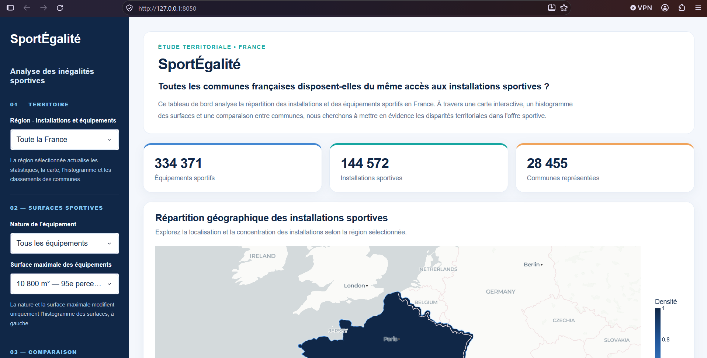
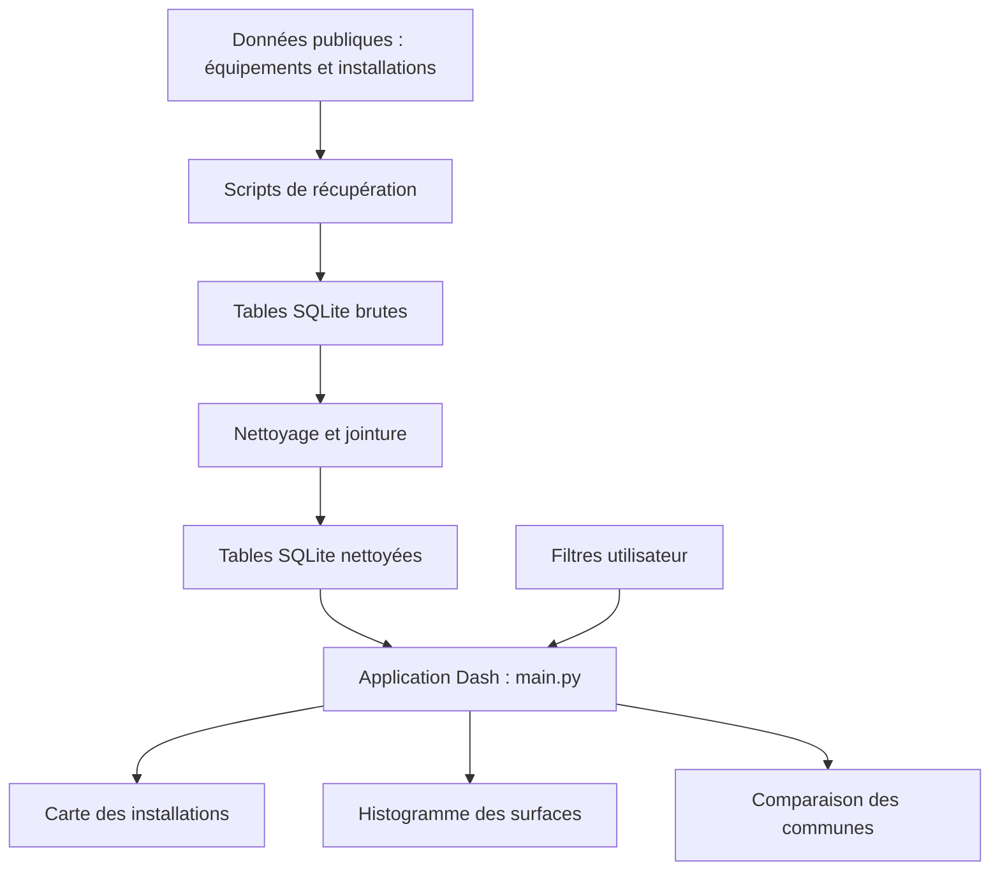

# SportÉgalité

### Analyse des disparités territoriales dans l'offre sportive en France

**Projet Python 2 — E4 DSIA**  
**ESIEE Paris — Année universitaire 2026-2027**

**Réalisé par :**
- Anella Manari
- Zelal Sahin

---

## Présentation du projet

### Contexte

En France, les installations et les équipements sportifs occupent une place importante dans la pratique des activités physiques. Pourtant, leur répartition peut varier d'une commune à l'autre, en fonction des caractéristiques et de l'organisation des territoires.

Dans le cadre de notre projet de Python 2, nous avons choisi d'étudier cette répartition à partir de données publiques. Notre objectif est de mieux comprendre les différences observées entre les communes françaises et de proposer une visualisation interactive des résultats.

### Problématique

**Toutes les communes françaises disposent-elles du même accès aux installations sportives ?**

Pour explorer cette question, nous avons développé **SportÉgalité**, un tableau de bord interactif réalisé avec Python, Dash et Plotly.

### Objectifs

Notre projet poursuit plusieurs objectifs :

1. Récupérer et exploiter des données publiques sur les installations et les équipements sportifs français.
2. Nettoyer et organiser ces données dans une base SQLite.
3. Représenter géographiquement la localisation des installations sportives.
4. Étudier la distribution des surfaces des équipements à l'aide d'un histogramme.
5. Comparer les communes selon leur nombre d'équipements et d'installations.
6. Permettre à l'utilisateur d'explorer les résultats grâce à des filtres interactifs.

### Notre démarche

Nous avons travaillé à partir de deux jeux de données complémentaires : les équipements sportifs et les installations sportives.

Après leur récupération, nous avons préparé les données pour les rendre exploitables dans notre application. Les informations nettoyées sont stockées dans une base SQLite et utilisées pour alimenter les différentes visualisations du dashboard.

L'application permet de sélectionner une région française, de consulter les installations sur une carte, d'examiner les surfaces des équipements et de comparer les communes selon plusieurs indicateurs.

Cette approche vise à mettre en évidence des disparités territoriales dans l'offre sportive. Elle ne permet toutefois pas, à elle seule, de mesurer précisément l'accessibilité des habitants, qui dépend également de facteurs tels que la population, les distances ou les conditions d'utilisation des installations.

---

## Sommaire

1. [Guide d'utilisation](#1-user-guide--guide-dutilisation)
2. [Sources et préparation des données](#2-data--sources-et-préparation-des-données)
3. [Guide du développeur](#3-developer-guide--guide-du-développeur)
4. [Rapport d'analyse](#4-rapport-danalyse--résultats-et-interprétation)
5. [Copyright et utilisation de l'IA](#5-copyright--originalité-du-projet-et-utilisation-de-lia)

---

## 1. User Guide — Guide d'utilisation

Cette section explique comment installer et utiliser SportÉgalité. L'application est accessible localement depuis un navigateur web et permet d'explorer les données sportives françaises sans connaissances particulières en programmation.

### 1.1. Prérequis

Pour exécuter le projet, les outils suivants sont nécessaires :

- **Git** : pour récupérer le dépôt.
- **Python 3.12** : version utilisée pendant le développement.
- **uv** : gestionnaire de projet Python permettant d'installer les dépendances.
- **Un navigateur web** : Firefox, Chrome ou Edge.

Les bibliothèques utilisées, notamment Dash, Plotly, Pandas et NumPy, sont déclarées dans `pyproject.toml`. Leur installation est assurée par `uv`.

**Installation de uv**

Le gestionnaire `uv` doit être installé avant l'exécution du projet.

La procédure d'installation est disponible dans la [documentation officielle de uv](https://docs.astral.sh/uv/getting-started/installation/).

Une fois l'installation terminée, la commande suivante permet de vérifier qu'il est disponible :

```bash
uv --version
```

### 1.2. Récupération du projet

Ouvrir un terminal et cloner le dépôt GitLab :

```bash
git clone git@git.esiee.fr:manaria/projet-sport-egalite.git
```

Se déplacer ensuite dans le dossier du projet :

```bash
cd projet-sport-egalite
```

La commande de clonage SSH nécessite un accès GitLab correctement configuré. Il est également possible d'utiliser l'URL HTTPS fournie par GitLab.

### 1.3. Installation des dépendances

Depuis la racine du projet, exécuter :

```bash
uv sync
```

Cette commande crée l'environnement virtuel si nécessaire et installe les dépendances définies dans le projet.

### 1.4. Lancement de l'application

Exécuter :

```bash
uv run python main.py
```

Ouvrir ensuite l'adresse suivante dans un navigateur :

http://127.0.0.1:8050/

Lors du premier lancement, si le fichier `data/db.sqlite` est absent, le programme restaure automatiquement la base de données à partir de l'archive `data/db.sqlite.gz`.

Cette restauration permet d'utiliser directement le dashboard sans devoir télécharger les fichiers CSV d'origine.

Pour arrêter le serveur, revenir dans le terminal et utiliser `Ctrl + C`.

### 1.5. Présentation du dashboard

L'interface SportÉgalité comprend plusieurs parties complémentaires.

**Les indicateurs principaux**

Trois cartes présentent le nombre d'équipements sportifs, le nombre d'installations sportives et le nombre de communes représentées dans les données.

Ces valeurs s'actualisent lorsque l'utilisateur sélectionne une région.

**La carte des installations sportives**

La carte interactive permet de visualiser la localisation et la concentration des installations sportives.

À l'échelle nationale, elle met en évidence les zones de concentration. Lorsqu'une région est sélectionnée, elle permet d'examiner plus précisément les installations du territoire.

**L'histogramme des surfaces**

L'histogramme représente la distribution des surfaces des équipements sportifs, exprimées en mètres carrés.

Chaque barre correspond à un intervalle de surfaces. Sa hauteur indique le nombre d'équipements appartenant à cet intervalle.

En passant la souris sur une barre, l'utilisateur peut consulter les informations correspondantes.

**La comparaison entre communes — Une fonctionnalité complémentaire**

En complément des visualisations principales, nous avons choisi d'intégrer un graphique de comparaison entre communes, même si cette fonctionnalité n'était pas explicitement demandée dans les consignes du projet.

Ce choix nous a semblé pertinent pour approfondir notre problématique : **« Toutes les communes françaises disposent-elles du même accès aux installations sportives ? »**

En effet, la carte permet de visualiser la localisation des installations, tandis que l'histogramme étudie la distribution des surfaces. Cependant, ces deux représentations ne permettent pas de comparer aussi directement les communes selon le nombre d'infrastructures dont elles disposent.

Nous avons donc ajouté un diagramme en barres horizontales présentant les dix communes comptant le plus d'équipements ou d'installations sportives dans la région sélectionnée.

Grâce aux deux options « Équipements » et « Installations », l'utilisateur peut changer le critère de comparaison et observer les différences entre les communes.

Cette fonctionnalité apporte ainsi une dimension supplémentaire à notre étude. Elle ne permet pas de mesurer à elle seule l'égalité d'accès au sport, mais elle aide à mettre en évidence les disparités dans la répartition des infrastructures.

### 1.6. Utilisation des filtres

Le menu latéral est organisé en deux groupes principaux.

**Filtre géographique**

Le choix de la région actualise :
- les trois indicateurs principaux ;
- la carte des installations ;
- l'histogramme des surfaces ;
- le classement des communes.

L'option « Toute la France » permet de revenir à une vue nationale.

**Filtres des équipements**

Deux filtres agissent uniquement sur l'histogramme des surfaces :

- **Nature de l'équipement** : tous les équipements, intérieur, découvert ou extérieur couvert.
- **Surface maximale** : affichage jusqu'à 10 800 m² ou jusqu'à 72 000 m².

Ces seuils permettent d'étudier les surfaces courantes ou d'élargir l'analyse aux équipements plus étendus.


### 1.7. Captures d'écran et présentation des visualisations

Afin de présenter plus concrètement les fonctionnalités de SportÉgalité, nous avons réalisé plusieurs captures d'écran de notre application. Elles illustrent la navigation, l'utilisation des filtres et les différentes représentations des données sportives.

#### 1.7.1. Vue générale du dashboard



*Figure 1 — Interface principale de SportÉgalité, avec la problématique, les filtres et les indicateurs statistiques.*

La page d'accueil présente notre problématique : **« Toutes les communes françaises disposent-elles du même accès aux installations sportives ? »**

Nous avons organisé l'interface autour d'un menu latéral et de plusieurs zones de visualisation. Cette disposition permet de conserver les filtres accessibles pendant la consultation des résultats.

Trois indicateurs principaux donnent une première vue d'ensemble des données nationales :

- **334 371 équipements sportifs** recensés dans la base ;
- **144 572 installations sportives** conservées après préparation des données ;
- **28 455 communes représentées** dans la sélection nationale.

Ces valeurs correspondent à la version des données utilisée lors de la capture. Elles sont recalculées lorsque l'utilisateur sélectionne une région.

Nous avons choisi de présenter ces indicateurs dès l'accueil pour donner un premier aperçu de l'étendue du jeu de données avant d'explorer les graphiques.

#### 1.7.2. Carte interactive des installations sportives


*Figure 2 — Répartition géographique des installations sportives en Bretagne et exemple d'infobulle au survol.*

La carte permet de visualiser la localisation des installations sportives sur le territoire français. En sélectionnant une région dans le menu latéral, l'utilisateur peut concentrer son observation sur un territoire particulier.

Dans cet exemple, nous avons sélectionné **la Bretagne**. Les points bleus représentent les installations sportives géolocalisées. Leur disposition permet de repérer les zones où les installations sont nombreuses et celles où elles semblent plus dispersées.

Nous avons également intégré une interaction au survol des points. Lorsqu'un utilisateur place sa souris sur une installation, une **infobulle (pop-up)** apparaît avec plusieurs renseignements :

- le nom de l'installation sportive ;
- la commune dans laquelle elle se trouve ;
- le département correspondant.

Sur notre capture, nous pouvons par exemple identifier le **Circuit de Randonnées de Manaty**, situé à Pleudaniel, dans les Côtes-d'Armor.

L'utilisateur peut également zoomer et déplacer la carte pour observer les installations plus précisément.

Cette fonctionnalité permet de passer d'une observation générale de la répartition géographique à l'identification d'installations particulières.

#### 1.7.3. Histogramme des surfaces des équipements sportifs


*Figure 3 — Distribution des surfaces des équipements sportifs en Bretagne, avec le menu de sélection de la nature des équipements.*

Nous avons réalisé un histogramme afin d'étudier la répartition des surfaces des équipements sportifs.

L'axe horizontal représente **la surface de l'aire de pratique en mètres carrés (m²)**, tandis que l'axe vertical indique **le nombre d'équipements sportifs**.

Les équipements sont regroupés dans des intervalles de surfaces. La hauteur de chaque barre correspond au nombre d'équipements dont la surface appartient à l'intervalle représenté.

Pour approfondir l'analyse, nous avons ajouté plusieurs filtres :

- **La région**, pour comparer les distributions territoriales ;
- **La nature de l'équipement**, pour distinguer notamment les équipements intérieurs, découverts ou extérieurs couverts ;
- **La surface maximale**, pour limiter les valeurs représentées et améliorer la lisibilité.

Les filtres actifs sont rappelés au-dessus de l'histogramme. Dans notre capture, nous avons sélectionné la Bretagne, tous les équipements et une surface maximale de 10 800 m².

Le menu déroulant permet de modifier la nature des équipements étudiés. Le graphique est alors recalculé automatiquement à partir de la sélection.

Au survol d'une barre, Plotly permet également de consulter les informations associées à l'intervalle de surfaces.

Dans cet exemple, nous observons que les premiers intervalles de surfaces regroupent une part importante des équipements représentés.

Le choix d'un histogramme nous semble adapté, car notre objectif est d'étudier la distribution d'une variable quantitative continue plutôt que de simplement comparer des catégories.

#### 1.7.4. Comparaison entre communes


*Figure 4 — Histogramme des surfaces et classement des dix communes bretonnes comptant le plus grand nombre d'équipements sportifs.*

Nous avons choisi d'aller au-delà des visualisations initialement attendues en ajoutant un graphique de comparaison entre communes. Cette fonctionnalité complémentaire nous semblait utile pour répondre plus précisément à notre problématique, en permettant de confronter directement les quantités d'équipements et d'installations sportives recensées sur différents territoires.

Nous avons choisi un **diagramme en barres horizontales**, car il facilite la lecture des noms de communes et la comparaison des valeurs.

Deux modes sont disponibles :

- **Équipements** : classement des dix communes possédant le plus grand nombre d'équipements sportifs ;
- **Installations** : classement des dix communes possédant le plus grand nombre d'installations sportives.

Le passage d'un mode à l'autre actualise automatiquement le graphique.

Dans notre exemple, le classement concerne la Bretagne. Brest et Rennes figurent en tête du classement des équipements sportifs dans les données utilisées.

Nous avons également intégré des **infobulles interactives**. Lorsqu'on passe la souris sur une barre, elles affichent le nom de la commune, son code INSEE et le nombre d'équipements ou d'installations recensés.

Sur notre capture, l'infobulle indique par exemple que **Lamballe-Armor compte 135 équipements sportifs**, avec le code INSEE **22093**.

Ce graphique permet d'identifier les communes qui concentrent le plus d'infrastructures sportives dans un territoire donné.

Cependant, les valeurs correspondent à des nombres absolus. Une commune plus peuplée peut naturellement compter davantage d'équipements. Nous ne pouvons donc pas conclure qu'elle offre nécessairement un meilleur accès au sport.

#### 1.7.5. Complémentarité des visualisations

Nous avons choisi ces trois représentations pour étudier des aspects différents des données :

- **La carte** permet d'observer la répartition géographique des installations.
- **L'histogramme** permet d'analyser la distribution des surfaces sportives.
- **Le classement** permet de comparer quantitativement les communes.

Ces visualisations sont complémentaires. Ensemble, elles permettent d'explorer la répartition de l'offre sportive à plusieurs échelles, tout en gardant à l'esprit les limites des indicateurs utilisés.


### 1.8. Vidéo de démonstration

Nous avons réalisé une vidéo commentée présentant le fonctionnement de SportÉgalité.

Cette démonstration montre la navigation dans le dashboard, les indicateurs statistiques, l'utilisation des filtres, la carte interactive et ses infobulles, l'histogramme des surfaces ainsi que la comparaison entre communes.

**[Visionner la démonstration de SportÉgalité](URL_DE_LA_VIDEO)**

## 2. Data — Sources et préparation des données

### 2.1. Sources des données

Pour notre étude, nous avons utilisé deux jeux de données publiques provenant des plateformes officielles du ministère chargé des Sports.

#### Équipements sportifs

- **Plateforme officielle :** https://data.sports.gouv.fr/
- **Jeu de données :** [Équipements sportifs — Export CSV](https://data.sports.gouv.fr/api/explore/v2.1/catalog/datasets/equipements-sportifs/exports/csv?lang=fr&timezone=Europe%2FBerlin&use_labels=true&delimiter=%3B)
- **Fichier local :** `data/raw/equipements_sportifs.csv`

Ce jeu de données contient les caractéristiques des équipements sportifs recensés en France, notamment leur identification, leur nature, leur type, leur surface et leur commune d'implantation.

Nous utilisons principalement ces informations pour étudier la distribution des surfaces et comparer le nombre d'équipements entre communes.

#### Installations sportives

- **Plateforme officielle :** https://equipements.sports.gouv.fr/
- **Jeu de données :** [Installations sportives — Export CSV](https://equipements.sports.gouv.fr/api/explore/v2.1/catalog/datasets/data-es-installation/exports/csv?delimiter=%3B)
- **Fichier local :** `data/raw/installations_sportives.csv`

Ce second jeu de données rassemble les informations relatives aux installations sportives, notamment leur identification, leur localisation géographique, leur commune, leur département et leur région.

Il est utilisé pour construire la carte interactive et enrichir les équipements avec des informations territoriales.

#### Complémentarité des deux sources

Un **équipement sportif** correspond à un espace destiné à la pratique d'une activité sportive, comme un terrain de football, une piscine ou un gymnase.

Une **installation sportive** correspond à un lieu pouvant regrouper un ou plusieurs équipements.

Cette distinction est importante dans notre étude : une même installation peut contenir plusieurs équipements sportifs. Il est donc nécessaire de différencier leurs effectifs lors des comparaisons.

Les URLs de téléchargement sont centralisées dans `config.py`, à travers les variables `EQUIPEMENTS_URL` et `INSTALLATIONS_URL`.

Les scripts `get_data.py` et `get_installation.py` utilisent ces adresses pour récupérer les fichiers CSV. Cette organisation facilite la maintenance du projet et permet de retrouver les sources originales.

### 2.2. Description des données

Les données sont fournies au format CSV. Elles contiennent des informations sur les équipements, les installations et leur localisation géographique.

Le fichier des équipements sportifs contient notamment :

- Le numéro d'identification de l'équipement.
- Le nom et le type d'équipement sportif.
- La nature de l'équipement : intérieur, découvert, extérieur couvert, etc.
- La surface de l'aire d'évolution.
- Le nom de la commune et son code INSEE.
- Le numéro de l'installation sportive associée.

Le fichier des installations contient notamment :

- Le numéro et le nom de l'installation.
- La commune et son code INSEE.
- Le département et la région.
- Les coordonnées géographiques.
- Des informations sur le type de territoire.

La variable quantitative principalement étudiée dans notre histogramme est la surface des équipements sportifs, exprimée en mètres carrés.

### 2.3. Récupération des données

La récupération des données est réalisée à l'aide des scripts Python du répertoire `src/utils/` :

- `get_data.py` : récupération des équipements sportifs.
- `get_installation.py` : récupération des installations sportives.

Les données brutes sont conservées afin de pouvoir distinguer les informations d'origine des données préparées pour l'analyse.

Les fichiers CSV téléchargés sont placés dans `data/raw/`, tandis que les données nécessaires au fonctionnement du dashboard sont intégrées à la base SQLite.

### 2.4. Nettoyage des équipements sportifs

Le nettoyage est réalisé dans `src/utils/clean_data.py`.

Pour les équipements, nous avons principalement travaillé sur les surfaces :

1. Conversion des surfaces en valeurs numériques avec Pandas.
2. Identification des valeurs manquantes ou non numériques.
3. Exclusion des surfaces nulles ou négatives de l'analyse quantitative.
4. Création de la colonne `surface_m2` contenant les surfaces exploitables.
5. Conservation de la nature d'origine dans `nature_equipement`.

Les équipements dont la surface est manquante ou invalide ne sont pas nécessairement supprimés de la base. Leur surface est enregistrée comme une valeur manquante, afin de ne pas fausser l'histogramme.

Cette méthode permet de préserver les autres informations utiles, notamment pour les comparaisons territoriales.

### 2.5. Nettoyage des installations sportives

Pour les installations, plusieurs opérations sont réalisées :

1. Suppression des doublons à partir du numéro d'installation.
2. Séparation des coordonnées géographiques en latitude et longitude.
3. Conversion des coordonnées en valeurs numériques.
4. Exclusion des installations dont les coordonnées sont manquantes ou invalides.
5. Harmonisation des codes de département.
6. Renommage des colonnes afin de faciliter leur utilisation dans le code Python.

Les installations dont les coordonnées sont inutilisables sont écartées de la table nettoyée pour éviter de placer des points erronés sur la carte.

### 2.6. Regroupement des arrondissements municipaux

Nous avons ajouté un traitement particulier pour Paris, Marseille et Lyon.

Dans les données d'origine, certains arrondissements possèdent leur propre code INSEE. Sans regroupement, ils peuvent apparaître comme des communes distinctes dans les comparaisons.

Pour éviter ce problème, la fonction `regrouper_arrondissements()` associe les arrondissements concernés à leur commune principale.

| Ville | Codes des arrondissements | Code de regroupement |
|---|---|---|
| Paris | 75101 à 75120 | 75056 |
| Marseille | 13201 à 13216 | 13055 |
| Lyon | 69381 à 69389 | 69123 |

Deux nouvelles colonnes sont créées :

- `code_commune` : code INSEE après regroupement.
- `nom_commune` : nom de la commune après regroupement.

Ce traitement permet d'obtenir des classements plus cohérents, sans séparer artificiellement ces trois grandes villes en plusieurs communes.

### 2.7. Organisation de la base SQLite

Nous utilisons SQLite pour conserver les données localement et permettre l'exécution du dashboard sans connexion Internet.

La base comprend quatre tables principales :

| Table | Contenu |
|---|---|
| `raw` | Données brutes des équipements sportifs |
| `cleaned` | Équipements nettoyés et enrichis |
| `raw_installations` | Données brutes des installations sportives |
| `cleaned_installations` | Installations nettoyées et géolocalisées |

Les tables brutes permettent de conserver les informations d'origine, tandis que les tables nettoyées sont utilisées par les visualisations de l'application.

Une jointure est effectuée à partir du numéro d'installation afin d'associer les équipements à leurs informations territoriales, notamment leur région, leur département et leur type de territoire.

Cette organisation évite de devoir relire et retraiter les fichiers CSV à chaque interaction avec le dashboard.

### 2.7.1. Volume des données

Les données stockées dans SQLite comprennent les tables suivantes :

| Table | Nombre de lignes |
|---|---:|
| `raw` | 334 371 |
| `cleaned` | 334 371 |
| `raw_installations` | 152 309 |
| `cleaned_installations` | 144 572 |


Ces effectifs ont été vérifiés directement dans notre base SQLite.

La table des équipements conserve les 334 371 enregistrements après le nettoyage. En effet, les surfaces manquantes ou invalides sont traitées sans entraîner systématiquement la suppression des équipements.

En revanche, le nettoyage des installations réduit leur nombre de 152 309 à 144 572 enregistrements, notamment après la suppression des doublons et des installations dont les coordonnées géographiques sont inutilisables.

Les tables nettoyées contiennent également les colonnes `code_commune` et `nom_commune`, utilisées pour regrouper les arrondissements municipaux de Paris, Marseille et Lyon.

### 2.8. Stockage local et reproductibilité

Le fichier SQLite utilisé pendant l'exécution est `data/db.sqlite`.

Pour faciliter le partage du projet, une version compressée de la base est conservée dans `data/db.sqlite.gz`.

Au premier lancement, si la base SQLite locale est absente, le script `prepare_database.py` permet de la restaurer à partir de cette archive.

Cette organisation présente deux avantages :

- Le dashboard peut fonctionner hors ligne avec les données déjà préparées.
- Les fichiers CSV d'origine n'ont pas besoin d'être téléchargés à chaque installation.

Les scripts de récupération et de nettoyage restent disponibles pour reconstruire les tables à partir des sources publiques.

### 2.8.1. Actualisation des données

Le projet distingue deux opérations :

- **L'utilisation du dashboard** : elle repose sur une base SQLite déjà préparée et ne nécessite pas de retélécharger les données.
- **La mise à jour des données** : elle nécessite de récupérer les données sources puis de relancer les traitements de nettoyage.

Le script `clean_data.py` effectue trois opérations principales :

1. Recréation de la table nettoyée des équipements sportifs.
2. Nettoyage des installations sportives, notamment de leurs coordonnées géographiques.
3. Jointure des données pour associer les équipements aux informations territoriales.

Le nettoyage peut être relancé depuis la racine du projet avec :

```bash
uv run python -m src.utils.clean_data
```

Cette opération remplace les tables nettoyées existantes. Il est donc recommandé de conserver une sauvegarde de la base avant toute actualisation.

### 2.9. Limites des données

Plusieurs limites doivent être prises en compte lors de l'interprétation des résultats.

Tout d'abord, les surfaces ne sont pas renseignées pour tous les équipements. Certaines valeurs très élevées peuvent également correspondre à de grands espaces naturels, qui ne sont pas directement comparables à des équipements sportifs traditionnels.

Ensuite, la présence d'une installation dans une commune ne garantit pas qu'elle soit accessible à tous les habitants : les horaires, le coût, la capacité d'accueil et les distances ne sont pas étudiés ici.

Enfin, les comparaisons réalisées dans le dashboard reposent principalement sur des nombres d'équipements ou d'installations. Elles ne sont pas systématiquement rapportées au nombre d'habitants.

Nos résultats permettent donc d'étudier la répartition territoriale de l'offre sportive, mais ne constituent pas une mesure complète de l'égalité d'accès à la pratique sportive.

---


## 3. Developer Guide — Guide du développeur

Cette section présente l'organisation technique de SportÉgalité. Elle permet de comprendre comment les différentes parties du projet communiquent et comment faire évoluer l'application.

### 3.1. Technologies utilisées

SportÉgalité repose principalement sur les technologies suivantes :

| Technologie | Utilisation |
|---|---|
| Python | Développement de l'application et traitement des données |
| Pandas | Manipulation, nettoyage et préparation des données |
| SQLite | Stockage des équipements et des installations sportives |
| Dash | Création de l'interface web interactive |
| Plotly | Réalisation de la carte, de l'histogramme et des graphiques |
| CSS | Personnalisation du design du dashboard |
| uv | Gestion de l'environnement Python et des dépendances |
| Git et GitLab | Versionnement du code et collaboration |

Nous avons séparé les traitements de données, les visualisations et l'interface afin de faciliter la maintenance du projet.

### 3.2. Organisation du projet

Voici les principaux fichiers et dossiers qui composent SportÉgalité :

```text
PROJET-SPORT-EGALITE/
│
├── .gitignore
├── README.md
├── main.py
├── config.py
├── pyproject.toml
├── uv.lock
│
├── assets/
│   ├── analyses.css
│   ├── style.css
│   └── zz_sidebar.css
│
├── data/
│   ├── db.sqlite.gz
│   └── raw/
│       └── .gitkeep
│
├── docs/
│   ├── analyse_equipements.md
│   └── images/
│       ├── comparaison_equip_insta.png
│       ├── dashboard_carte_region.png
│       ├── dashboard_vue_generale.png
│       └── histogramme_surfaces.png
│
├── src/
│   ├── __init__.py
│   │
│   ├── components/
│   │   ├── __init__.py
│   │   ├── histogram.py
│   │   ├── histogram_layout.py
│   │   ├── inegalites_chart.py
│   │   ├── map_chart.py
│   │   └── map_layout.py
│   │
│   ├── pages/
│   │   └── __init__.py
│   │
│   └── utils/
│       ├── __init__.py
│       ├── clean_data.py
│       ├── get_data.py
│       ├── get_installation.py
│       └── prepare_database.py
│
└── tests/
    ├── test_clean_data.py
    ├── test_histogram.py
    └── test_jointure.py

```

Le fichier `data/db.sqlite` est généré ou restauré localement et n'est pas destiné à être versionné dans Git.

### 3.3. Rôle des principaux fichiers

**Les fichiers `__init__.py` — Organisation des modules Python**

Les fichiers `__init__.py` permettent d'organiser les dossiers du projet en packages Python. Ils facilitent l'importation des fonctions entre les différents modules.

Le dossier `src/pages/` est également présent dans notre structure. Il ne contient actuellement qu'un fichier `__init__.py` et ne correspond donc pas à une page supplémentaire du dashboard.

**`main.py` — Application principale**

Ce fichier constitue le point d'entrée de SportÉgalité.

Il initialise l'application Dash, organise les différents éléments de l'interface et relie les composants interactifs aux fonctions qui produisent les graphiques.

Il permet notamment de mettre à jour les visualisations selon les choix de l'utilisateur.

**`config.py` — Configuration générale**

Ce fichier centralise les paramètres du projet, notamment les chemins des fichiers de données et les adresses utilisées pour leur téléchargement.

Le regroupement de ces paramètres évite de répéter les mêmes chemins dans plusieurs scripts.

**`src/components/` — Visualisations**

Ce dossier contient les fonctions utilisées pour construire les éléments graphiques :

- `histogram.py` : création de l'histogramme des surfaces.
- `histogram_layout.py` : présentation de la section consacrée aux surfaces.
- `map_chart.py` : génération de la carte des installations sportives.
- `map_layout.py` : organisation de la section cartographique.
- `inegalites_chart.py` : comparaison des communes selon leur nombre d'équipements ou d'installations.

Cette séparation facilite les modifications : il est possible d'améliorer un graphique sans réécrire toute l'application.

**`src/utils/` — Préparation des données**

Ce dossier regroupe les fonctions permettant de récupérer, nettoyer et préparer les données :

- `get_data.py` : récupération des équipements.
- `get_installation.py` : récupération des installations.
- `clean_data.py` : nettoyage des données et jointure territoriale.
- `prepare_database.py` : restauration de la base SQLite si elle est absente.

**`assets/` — Mise en forme**

Les fichiers CSS permettent de personnaliser l'interface : couleurs, disposition des cartes, menu latéral, graphiques et adaptation de certains composants.

Dash charge automatiquement les feuilles de style présentes dans ce dossier.

**`tests/` — Vérification du code**

Ce dossier contient les tests automatisés permettant de contrôler certaines fonctionnalités, notamment le nettoyage des données, les jointures et le traitement des surfaces.

### 3.4. Architecture générale

Le fonctionnement de SportÉgalité peut être représenté par le diagramme suivant :



Les données sont préparées et enregistrées dans SQLite. L'application Dash interroge ensuite ces tables pour produire les visualisations.

Lorsqu'un utilisateur modifie un filtre, les composants concernés sont actualisés sans qu'il soit nécessaire de relancer le programme.

### 3.5. Fonctionnement des interactions Dash

Les interactions du dashboard reposent sur le principe des callbacks Dash.

Un callback relie une ou plusieurs entrées, comme un menu déroulant, à une ou plusieurs sorties, comme un graphique ou un indicateur.

Dans SportÉgalité, les interactions principales sont les suivantes :

1. **Sélection d'une région** : mise à jour de la carte, de l'histogramme, des indicateurs et du classement.
2. **Choix de la nature de l'équipement** : filtrage des données de l'histogramme.
3. **Modification de la surface maximale** : adaptation de la plage de surfaces affichée.
4. **Choix du type de comparaison** : affichage du classement des équipements ou des installations.

La séparation entre les fonctions de visualisation et les callbacks permet de conserver un code plus lisible.

### 3.6. Ajouter une nouvelle visualisation

L'architecture du projet permet d'ajouter un graphique sans modifier les scripts de récupération des données.

Par exemple, pour créer une visualisation présentant le nombre d'équipements par nature :

1. Identifier les colonnes nécessaires dans la table `cleaned`.
2. Créer un nouveau fichier Python dans `src/components/`, par exemple `nature_chart.py`.
3. Écrire une fonction qui récupère les données utiles depuis SQLite.
4. Construire le graphique avec Plotly.
5. Importer cette fonction dans `main.py`.
6. Ajouter un composant `dcc.Graph` dans la mise en page.
7. Créer ou adapter un callback si le graphique doit réagir aux filtres.
8. Tester le résultat avec plusieurs régions et valeurs de filtres.

Cette méthode permet de réutiliser les données et les composants existants tout en limitant les modifications du reste de l'application.

### 3.7. Tests et qualité du code

Nous utilisons des tests automatisés et des outils de vérification pour contrôler le fonctionnement du projet.

Pour lancer les tests :

```bash
uv run pytest
```

Pour vérifier les règles de qualité avec Ruff :

```bash
uv run ruff check .
```

Pour contrôler le formatage :

```bash
uv run ruff format --check .
```

Ces vérifications aident à détecter les erreurs, à conserver une présentation cohérente du code et à limiter les régressions lors des modifications.

La version finale doit être vérifiée après l'intégration des contributions des deux membres du groupe.


En complément des tests automatisés, la qualité du code peut être examinée avec d'autres outils :

- **Pylint** : analyse statique de la qualité du code.
- **Mypy** : vérification des annotations de types.
- **Radon** : mesure de la complexité du code.

Ces outils permettent d'identifier des points d'amélioration complémentaires à ceux détectés par Ruff.


### 3.8. Organisation du travail avec Git

Nous avons utilisé GitLab pour collaborer sur SportÉgalité.

Le développement a été organisé autour de plusieurs branches :

- `main` : branche destinée à contenir la version finale du projet.
- `dev` : branche d'intégration utilisée pour réunir les fonctionnalités.
- `anella` : branche de développement d'Anella.
- `zelal` : branche de développement de Zelal.

Les modifications sont enregistrées sous forme de commits, puis intégrées à l'aide de fusions Git.

Cette organisation permet aux deux membres du groupe de travailler sur différentes fonctionnalités tout en conservant l'historique des modifications.

---


## 4. Rapport d'analyse — Résultats et interprétation

### 4.1. Objectif de l'analyse

L'objectif de notre étude est d'examiner les différences de répartition des équipements et des installations sportives entre les communes françaises.

Pour cela, nous nous appuyons sur les visualisations développées dans SportÉgalité : la carte géographique, l'histogramme des surfaces et le classement des communes.

Ces représentations permettent d'observer plusieurs aspects de l'offre sportive :
- La répartition géographique des installations.
- Les différences de surfaces entre les équipements.
- Les communes qui concentrent le plus grand nombre d'équipements ou d'installations.
- Les variations observées selon les régions.

### 4.2. Analyse des résultats

Le rapport d'analyse détaille les observations réalisées à partir des données et des graphiques du dashboard.

Il présente les principaux résultats chiffrés, leur interprétation ainsi que les limites de notre démarche.

**Consulter le rapport complet : ( rapport zelal)

### 4.3. Précautions d'interprétation

Les différences observées ne permettent pas, à elles seules, de conclure qu'une commune offre un meilleur accès au sport qu'une autre.

En effet, notre étude ne tient pas systématiquement compte de la population des communes, de la distance entre les habitants et les installations ou des conditions d'accès aux équipements.

Les résultats doivent donc être interprétés comme une analyse de la répartition territoriale de l'offre sportive, et non comme une mesure exhaustive de l'accessibilité sportive.

---


## 5. Copyright — Originalité du projet et utilisation de l'IA

### 5.1. Déclaration d'originalité

Le projet SportÉgalité a été réalisé dans le cadre du module Python 2 de la quatrième année du cursus ingénieur, filière Data Science et Intelligence Artificielle (DSIA), à l'ESIEE Paris.

Nous attestons que le projet a été développé dans le cadre de notre travail en binôme. Nous avons utilisé des bibliothèques Python, de la documentation technique et, pour certaines étapes, des outils d'assistance par intelligence artificielle.

Nous distinguons dans cette section nos contributions des éventuels emprunts de code et des propositions générées à l'aide de ces outils.

Les portions de code reprises ou adaptées à partir de sources extérieures doivent être identifiées et accompagnées de leurs références et d'une explication.

Les données exploitées proviennent de ressources publiques et les bibliothèques Python utilisées sont des outils tiers, conformément à leurs licences respectives.

L'utilisation de ressources extérieures et d'outils d'intelligence artificielle est précisée dans les sections suivantes afin de distinguer notre travail des aides utilisées.

### 5.2. Répartition du travail

Le projet a été réalisé en binôme.

| Membre | Contributions principales |
|---|---|
| Anella Manari | Récupération et exploitation des équipements sportifs, intégration SQLite, développement et amélioration des visualisations, interface du dashboard, documentation README |
| Zelal Sahin | Récupération et préparation des installations sportives, traitements territoriaux, amélioration du regroupement des communes et rédaction du rapport d'analyse |

Les deux membres ont également participé aux échanges, à l'intégration des modifications et aux vérifications du projet.

Cette répartition présente les principales responsabilités, sans exclure les contributions communes sur certaines fonctionnalités.

### 5.3. Sources et bibliothèques utilisées

Les principales ressources utilisées pendant le développement sont :

**Sources des données**
- https://data.sports.gouv.fr/
- https://equipements.sports.gouv.fr/

**Documentation technique**
- Python : https://docs.python.org/3/
- Pandas : https://pandas.pydata.org/docs/
- Dash : https://dash.plotly.com/
- Plotly : https://plotly.com/python/
- SQLite : https://docs.python.org/3/library/sqlite3.html
- uv : https://docs.astral.sh/uv/

Ces ressources ont été utilisées pour comprendre les fonctionnalités des bibliothèques, consulter les syntaxes et organiser le développement de l'application.

### 5.4. Utilisation de l'intelligence artificielle

Nous avons utilisé ChatGPT comme outil d'accompagnement pendant certaines étapes du développement de SportÉgalité.

Cet outil a notamment été utilisé pour :

- Comprendre le fonctionnement de certaines bibliothèques Python, notamment Pandas, Dash et Plotly.
- Rechercher des pistes pour organiser les fichiers et structurer l'application.
- Proposer ou adapter certaines portions de code liées aux visualisations, à l'interface et aux interactions.
- Comprendre des messages d'erreur et identifier des solutions possibles.
- Accompagner les manipulations Git et les opérations de fusion.
- Aider à la rédaction et à la structuration du README.

Les propositions obtenues ont été intégrées et adaptées au projet au cours du développement. Leur fonctionnement doit être vérifié à l'aide des tests et de l'exécution de l'application.

L'intelligence artificielle a été utilisée comme une aide au développement et à la documentation, et non comme une source de données pour l'analyse.


### 5.5. Traçabilité des aides extérieures

Afin de rendre notre démarche transparente, nous distinguons les ressources documentaires, les aides à la compréhension et les éventuelles propositions de code obtenues à l'aide d'outils externes.

| Partie du projet | Type d'assistance à documenter | Vérification |
|---|---|---|
| `main.py` | Organisation de l'interface et callbacks Dash | À vérifier |
| `src/components/histogram.py` | Construction et filtrage de l'histogramme | À vérifier |
| `src/components/map_chart.py` | Carte géographique et infobulles | À vérifier |
| `src/components/inegalites_chart.py` | Classement des communes et requêtes SQL | À vérifier |
| `src/utils/clean_data.py` | Traitements Pandas et préparation SQLite | À vérifier |
| `README.md` | Assistance à la rédaction et à la structuration | ChatGPT |

**Remarque :** ce tableau est un inventaire de vérification. Il doit être complété pour identifier précisément les éventuelles portions de code empruntées ou générées, les outils utilisés et leur fonctionnement.

Les sources et les prompts structurants, lorsque leur déclaration est requise, seront joints à cette section ou à un document annexe.
