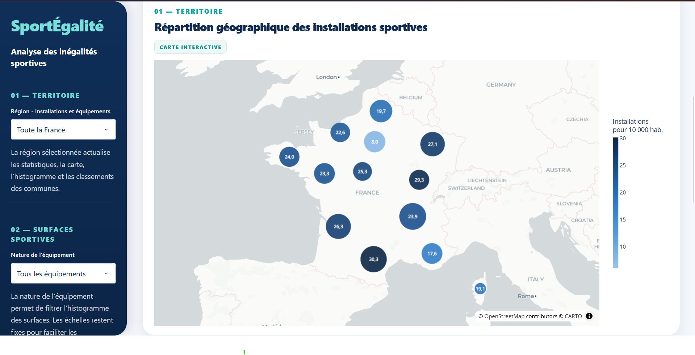
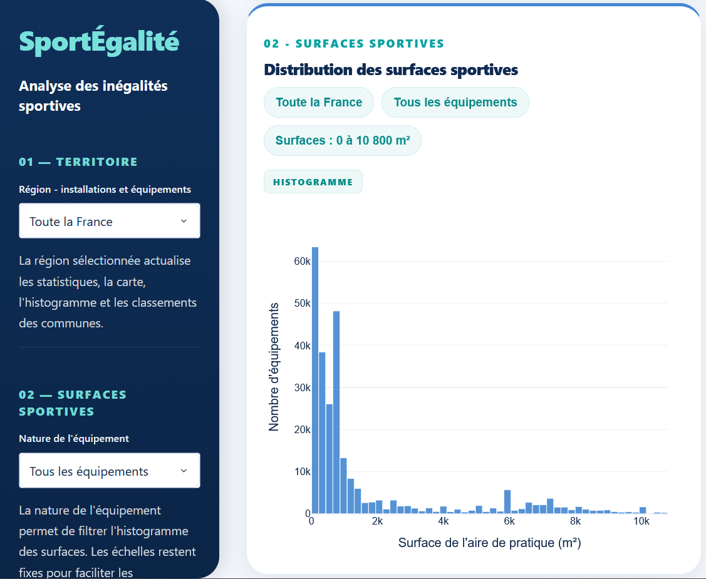
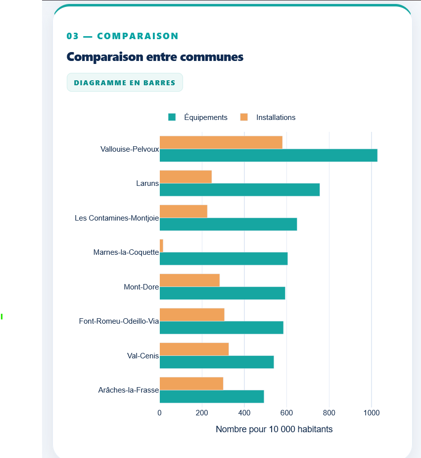
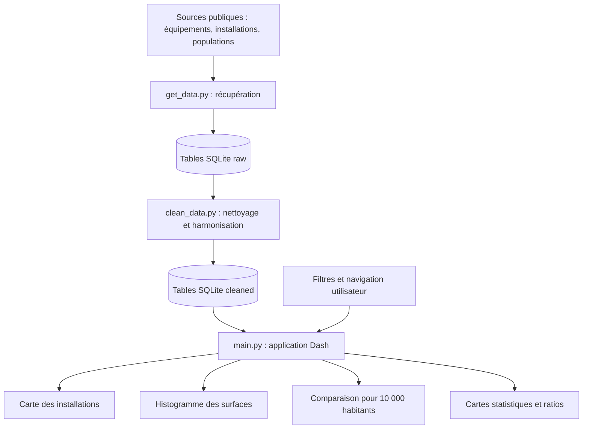

# SportÉgalité

### Analyse des disparités territoriales dans l'offre sportive en France

**Projet Python 2 — E4 DSIA**  
**ESIEE Paris — Année universitaire 2026-2027**

**Réalisé par :**
- Anella Manari
- Zelal Sahin

---

## Présentation du projet

### Contexte

En France, les installations et les équipements sportifs occupent une place importante dans la pratique des activités physiques. Pourtant, leur répartition peut varier d'une commune à l'autre, en fonction des caractéristiques et de l'organisation des territoires.

Dans le cadre de notre projet de Python 2, nous avons choisi d'étudier cette répartition à partir de données publiques. Notre objectif est de mieux comprendre les différences observées entre les communes françaises et de proposer une visualisation interactive des résultats.

### Problématique

**Toutes les communes françaises disposent-elles du même accès aux installations sportives ?**

Pour explorer cette question, nous avons développé **SportÉgalité**, un tableau de bord interactif réalisé avec Python, Dash et Plotly.

### Objectifs

Notre projet poursuit plusieurs objectifs :

1. Récupérer et exploiter des données publiques sur les installations et les équipements sportifs français, ainsi que sur la population des communes.
2. Nettoyer, harmoniser et organiser ces données dans une base SQLite.
3. Représenter géographiquement la localisation et la concentration des installations sportives sur une carte interactive.
4. Étudier la distribution des surfaces des équipements à l'aide d'un histogramme.
5. Comparer les communes selon leur nombre d'équipements et d'installations **rapporté à 10 000 habitants**.
6. Permettre à l'utilisateur d'explorer les résultats grâce à des filtres, des infobulles explicatives et une navigation directe vers les visualisations.

### Notre démarche

Nous avons travaillé à partir de **trois ensembles de données complémentaires** : les équipements sportifs, les installations sportives et les populations communales. Les deux premiers décrivent les infrastructures ; le troisième nous permet de tenir compte de la taille des communes.

Après leur récupération, nous avons préparé les données pour les rendre exploitables dans notre application. Les informations nettoyées sont stockées dans une base SQLite et utilisées pour alimenter les différentes visualisations du dashboard.

L'application permet de sélectionner une région française, de consulter la répartition des installations sur une carte, d'examiner les surfaces des équipements et de comparer les communes à l'aide de ratios pour 10 000 habitants.

Notre démarche vise à montrer des **différences de dotation territoriale**. Elle ne constitue toutefois pas une mesure complète de l'accessibilité : le nombre d'infrastructures par habitant ne renseigne pas directement sur les distances, le coût, les horaires, la capacité d'accueil ou les usages touristiques.

---

## Sommaire

1. [Guide d'utilisation](#1-user-guide--guide-dutilisation)
2. [Sources et préparation des données](#2-data--sources-et-préparation-des-données)
3. [Guide du développeur](#3-developer-guide--guide-du-développeur)
4. [Rapport d'analyse](#4-rapport-danalyse--résultats-et-interprétation)
5. [Copyright et utilisation de l'IA](#5-copyright--originalité-du-projet-et-utilisation-de-lia)

---

## 1. User Guide — Guide d'utilisation

Cette section explique comment installer et utiliser SportÉgalité. L'application est accessible localement depuis un navigateur web et permet d'explorer les données sportives françaises sans connaissances particulières en programmation.

### 1.1. Prérequis

Pour exécuter le projet, les outils suivants sont nécessaires :

- **Git** : pour récupérer le dépôt.
- **Python 3.12** : version utilisée pendant le développement.
- **uv** : gestionnaire de projet Python permettant d'installer les dépendances.
- **Un navigateur web** : Firefox, Chrome ou Edge.

Les bibliothèques utilisées, notamment Dash, Plotly, Pandas et NumPy, sont déclarées dans `pyproject.toml`. Leur installation est assurée par `uv`.

**Installation de uv**

Le gestionnaire `uv` doit être installé avant l'exécution du projet. La procédure d'installation est disponible dans la [documentation officielle de uv](https://docs.astral.sh/uv/getting-started/installation/).

Une fois l'installation terminée, vérifier sa disponibilité :

```bash
uv --version
```

### 1.2. Récupération du projet

Ouvrir un terminal et cloner le dépôt GitLab :

```bash
git clone git@git.esiee.fr:manaria/projet-sport-egalite.git
```

Se déplacer ensuite dans le dossier du projet :

```bash
cd projet-sport-egalite
```

La commande de clonage SSH nécessite un accès GitLab correctement configuré. Il est également possible d'utiliser l'URL HTTPS fournie par GitLab.

### 1.3. Installation des dépendances

Depuis la racine du projet, exécuter :

```bash
uv sync
```

Cette commande crée l'environnement virtuel si nécessaire et installe les dépendances déclarées dans le projet. Le fichier `uv.lock` conserve les versions résolues des bibliothèques.

### 1.4. Lancement de l'application

Exécuter :

```bash
uv run python main.py
```

Ouvrir ensuite dans un navigateur : http://127.0.0.1:8050/

Lors du premier lancement, si le fichier `data/db.sqlite` est absent, le programme restaure automatiquement la base de données à partir de l'archive `data/db.sqlite.gz`.

Cette restauration permet d'utiliser directement le dashboard sans devoir télécharger les fichiers CSV d'origine.

Pour arrêter le serveur, revenir dans le terminal et utiliser `Ctrl + C`.

### 1.5. Présentation du dashboard

L'interface SportÉgalité comprend plusieurs parties complémentaires. Dès l'accueil, trois liens permettent d'accéder directement aux sections : **01 — Explorer le territoire**, **02 — Analyser les surfaces** et **03 — Comparer les communes**. Un clic fait défiler la page jusqu'au graphique correspondant, dont l'encadré est mis en évidence.

**Les indicateurs principaux**

Trois statistiques présentent le nombre d'**équipements sportifs**, d'**installations sportives** et de **communes représentées** dans les données. Les deux premières affichent également leur nombre **pour 10 000 habitants** dans le territoire sélectionné. Ces ratios sont des quantités par habitant, **pas des pourcentages**.

Les valeurs sont mises à jour lorsqu'une région est choisie. Des infobulles expliquent simplement la différence entre équipement, installation et commune représentée.

**La carte des installations sportives**

La carte interactive présente la localisation et la concentration des installations sportives géolocalisées. Pour limiter l'accumulation de marqueurs à l'écran, les installations sont **regroupées selon le niveau de zoom** ; les groupes se détaillent lorsque l'utilisateur zoome sur une zone. Le filtre régional permet de concentrer la consultation sur un territoire.

**L'histogramme des surfaces**

L'histogramme représente la distribution des surfaces des aires de pratique sportive, exprimées en mètres carrés. Chaque barre correspond à un intervalle de surfaces ; sa hauteur indique le nombre d'équipements appartenant à cet intervalle.

L'axe horizontal est **fixé de 0 à 10 800 m²**, avec 50 intervalles, pour conserver une même lecture d'une région à l'autre. Le filtre « Nature de l'équipement » permet de distinguer notamment les équipements intérieurs, découverts et extérieurs couverts. Au survol, l'infobulle précise notamment l'intervalle, l'effectif et les principaux types d'équipements recensés, ainsi que des informations contextualisées par la population.

**La comparaison entre communes — Une fonctionnalité complémentaire**

En complément de la carte et de l'histogramme, nous avons ajouté un **diagramme en barres horizontales** pour comparer les dotations sportives des communes en tenant compte de leur population. Cette fonctionnalité répond directement à notre problématique : un nombre élevé d'infrastructures dans une grande ville ne signifie pas nécessairement une offre plus importante par habitant.

Le graphique réunit **les cinq communes les mieux dotées en équipements** et **les cinq communes les mieux dotées en installations**, selon leur nombre pour **10 000 habitants**. Les deux catégories apparaissent **en même temps**, sous forme de barres turquoise (équipements) et orange (installations). Les communes présentes dans les deux classements ne figurent qu'une fois ; le graphique peut donc comporter moins de dix communes.

Le classement ne retient que les communes comptant **au moins 1 000 habitants**, pour limiter les ratios extrêmes de communes très peu peuplées. Les infobulles présentent la population, le nombre réel d'infrastructures et le ratio correspondant. Elles indiquent également les principaux **types d'équipements** ou des **exemples de noms d'installations**, selon la couleur survolée.

### 1.6. Utilisation des filtres

Le menu latéral est organisé autour de deux groupes principaux.

**Filtre géographique**

Le choix d'une région actualise :

- les trois indicateurs principaux et les ratios pour 10 000 habitants ;
- la carte des installations ;
- l'histogramme des surfaces ;
- la comparaison entre communes.

L'option **« Toute la France »** permet de revenir à une vue nationale. Le menu contient un champ de recherche pour retrouver plus facilement une région.

**Filtre des équipements**

Le menu **« Nature de l'équipement »** agit uniquement sur l'histogramme : il permet d'afficher tous les équipements ou de filtrer certaines natures, comme « Intérieur », « Découvert » ou « Extérieur couvert ».


### 1.7. Captures d'écran et présentation des visualisations

Afin de présenter plus concrètement les fonctionnalités de SportÉgalité, nous avons réalisé plusieurs captures d'écran de notre application. Elles illustrent la navigation, l'utilisation des filtres et les différentes représentations des données sportives.

#### 1.7.1. Vue générale du dashboard


Figure 1 — Page d'accueil de SportÉgalité présentant la problématique, les filtres, les raccourcis de navigation et les principaux indicateurs statistiques.

La page d'accueil constitue le point de départ de notre analyse. Nous avons souhaité proposer une interface simple à utiliser, dans laquelle les informations essentielles sont visibles dès l'ouverture de l'application.

En haut de la page, nous présentons notre problématique : « Toutes les communes françaises disposent-elles du même accès aux installations sportives ? ». Cette question guide les différentes visualisations du dashboard.

Nous avons organisé l'interface autour de trois parties principales : la répartition géographique des installations sportives, la distribution des surfaces des équipements et la comparaison entre communes.

Pour faciliter la navigation, nous avons ajouté trois raccourcis numérotés sous la problématique. En cliquant sur l'un d'eux, l'utilisateur est directement dirigé vers la visualisation correspondante. Cela permet de passer rapidement d'une analyse à l'autre sans devoir parcourir manuellement toute la page.

Le menu latéral, situé à gauche, regroupe les filtres disponibles. Le premier permet de sélectionner une région française ou de conserver une vue nationale avec l'option « Toute la France ». Le second permet de choisir la nature des équipements représentés dans l'histogramme.

Sous l'en-tête, trois cartes statistiques donnent une première vue d'ensemble des données. Pour la sélection nationale présentée sur la capture, elles indiquent :

334 371 équipements sportifs recensés ;

144 564 installations sportives recensées dans la table nettoyée ;

28 455 communes représentées parmi celles disposant d'au moins un équipement dans les données.

Nous avons également ajouté deux indicateurs rapportés à la population. Sur cette capture, ils correspondent à environ 48,5 équipements et 21,0 installations pour 10 000 habitants.

Cette distinction est importante : les nombres absolus permettent de connaître le volume d'infrastructures, tandis que les ratios donnent une indication de l'offre disponible par rapport au nombre d'habitants.

Les cartes comportent aussi des icônes d'information. Au survol, des explications permettent de comprendre simplement la différence entre un équipement sportif et une installation sportive, ainsi que la signification des communes représentées.

Enfin, l'ensemble des indicateurs se met à jour lorsqu'une autre région est sélectionnée. Nous avons privilégié cette présentation pour que l'utilisateur dispose immédiatement d'une vue globale des données avant de passer aux analyses plus détaillées.

#### 1.7.2. Carte interactive des installations sportives



#### 1.7.2. Carte interactive des installations sportives


*Figure 2 — Carte interactive représentant la répartition territoriale des installations sportives, à l'aide de marqueurs regroupés et d'une échelle de couleur.*

La carte constitue la première visualisation de notre dashboard. Elle permet de représenter géographiquement les installations sportives recensées et d'observer les différences entre les territoires.

Nous avons choisi une représentation cartographique, car la localisation des infrastructures est importante pour comprendre leur répartition. Deux territoires peuvent posséder un nombre comparable d'installations, mais celles-ci peuvent être concentrées dans quelques zones ou réparties sur une surface plus importante.

Pour rendre la carte plus lisible, nous avons adopté un système de regroupement des installations en fonction du niveau de zoom.

À une échelle large, afficher chaque installation individuellement produirait un nombre important de points, parfois superposés. Les installations sont donc regroupées en marqueurs, ce qui facilite la lecture de la carte et permet d'identifier les zones présentant des concentrations différentes.

La représentation utilise également des variations de couleur. La légende située à droite de la carte indique un nombre d'installations rapporté à **10 000 habitants**. Cet indicateur permet de mettre en relation la quantité d'infrastructures et la population des territoires représentés.

L'utilisateur peut interagir avec la carte de plusieurs manières :

- **Sélectionner une région** dans le menu latéral pour concentrer son analyse sur un territoire.
- **Zoomer ou dézoomer** afin de modifier l'échelle d'observation.
- **Déplacer la carte** pour examiner différentes zones géographiques.
- **Consulter les informations associées aux marqueurs** pour obtenir davantage de précisions sur les territoires représentés.

L'utilisation de regroupements permet de passer progressivement d'une vue d'ensemble à une observation plus locale, tout en limitant la superposition des informations.

Cette carte constitue un premier outil d'analyse des disparités territoriales. Elle nous aide à repérer les contrastes géographiques et à identifier des territoires qu'il peut être intéressant d'étudier plus précisément.

Il faut néanmoins distinguer la présence d'installations de leur accessibilité réelle. La carte ne renseigne pas directement sur les temps de trajet, les tarifs, les horaires d'ouverture ou les conditions d'utilisation des infrastructures.

#### 1.7.3. Histogramme des surfaces des équipements sportifs



#### 1.7.3. Histogramme des surfaces des équipements sportifs


*Figure 3 — Histogramme présentant la distribution des surfaces des équipements sportifs, avec les filtres de région et de nature ainsi qu'une plage de surfaces fixe.*

La deuxième visualisation est un histogramme consacré aux surfaces des équipements sportifs. Nous avons choisi cette représentation pour étudier la manière dont les équipements se répartissent selon la taille de leur aire de pratique.

Contrairement à un diagramme en barres classique qui compare des catégories, l'histogramme permet d'étudier la distribution d'une variable quantitative. Dans notre cas, cette variable est la **surface de l'aire d'évolution, exprimée en mètres carrés**.

L'axe horizontal représente les surfaces comprises entre **0 et 10 800 m²**, tandis que l'axe vertical indique le nombre d'équipements appartenant à chaque intervalle.

Nous avons découpé cette plage en **50 intervalles de même largeur**, soit 216 m² par intervalle. Chaque barre correspond donc à un ensemble d'équipements dont les surfaces se situent dans une plage donnée.

Nous avons volontairement conservé une plage horizontale fixe, afin de pouvoir comparer plus facilement les distributions lorsque l'utilisateur sélectionne différentes régions.

Deux filtres permettent d'adapter l'analyse :

- **Le filtre de région**, commun aux autres visualisations, permet d'étudier les équipements d'un territoire particulier.
- **Le filtre de nature**, propre à l'histogramme, permet de distinguer les équipements intérieurs, découverts ou extérieurs couverts, ou de conserver l'ensemble des équipements.

Les filtres actifs sont rappelés au-dessus du graphique, sous forme de petites étiquettes. Cela permet à l'utilisateur de connaître immédiatement les données affichées.

Nous avons également intégré des infobulles interactives. Lorsqu'on survole une barre, l'application affiche des renseignements complémentaires sur l'intervalle étudié, notamment le nombre d'équipements et les types d'équipements les plus représentés.

Ces informations permettent de comprendre ce que contient chaque intervalle. Une barre élevée indique qu'un grand nombre d'équipements possède une surface comprise dans la plage correspondante.

Dans la vue nationale présentée sur la capture, nous observons que les premières classes de surfaces regroupent une quantité importante d'équipements. À mesure que la surface augmente, les effectifs deviennent globalement plus faibles, même si certains intervalles présentent des concentrations particulières.

Cette distribution suggère que les équipements de petite ou moyenne surface sont nombreux dans les données étudiées. Il faut cependant rester prudent : des espaces sportifs très différents peuvent posséder des surfaces comparables.

Enfin, les surfaces manquantes, nulles, négatives ou non exploitables ne sont pas utilisées pour construire l'histogramme. Elles ne sont pas nécessairement supprimées de la base, car les équipements concernés peuvent rester utiles pour les autres analyses.

Nous avons donc cherché à obtenir un graphique à la fois lisible, interactif et cohérent pour comparer les surfaces sportives entre régions.

#### 1.7.4. Comparaison entre communes



#### 1.7.4. Comparaison entre communes


*Figure 4 — Diagramme en barres horizontales comparant les équipements et les installations sportives rapportés à 10 000 habitants, pour les communes sélectionnées.*

Pour compléter la carte et l'histogramme, nous avons ajouté une troisième visualisation : un **diagramme en barres horizontales permettant de comparer les communes**.

Cette fonctionnalité nous semblait importante pour répondre à notre problématique. En effet, observer la localisation des installations ou la distribution des surfaces ne suffit pas à comprendre les différences d'offre sportive entre les communes.

Nous avons d'abord envisagé une comparaison à partir du nombre total d'équipements ou d'installations. Cependant, cette méthode présentait une limite : une grande commune possède généralement davantage d'infrastructures qu'une commune moins peuplée, sans être nécessairement mieux dotée par habitant.

Nous avons donc choisi d'utiliser un indicateur commun : **le nombre d'équipements ou d'installations pour 10 000 habitants**.

Ce ratio est obtenu en divisant le nombre d'infrastructures par la population de la commune, puis en multipliant le résultat par 10 000.

Afin de représenter les deux catégories dans un même graphique, nous avons conservé deux couleurs :

- **Les barres turquoise** correspondent aux équipements sportifs pour 10 000 habitants.
- **Les barres orange** correspondent aux installations sportives pour 10 000 habitants.

Les deux barres apparaissent simultanément pour chaque commune. Cette présentation permet de comparer visuellement les équipements et les installations, sans devoir changer de mode d'affichage.

Nous avons également mis en place un classement qui réunit **les cinq communes les mieux dotées en équipements et les cinq communes les mieux dotées en installations**, selon leurs ratios respectifs.

Une commune présente dans les deux classements n'apparaît qu'une seule fois. Le nombre total de communes affichées peut donc être inférieur à dix.

Pour limiter les effets liés aux très faibles populations, nous avons retenu uniquement les communes comptant **au moins 1 000 habitants**.

La sélection des communes s'adapte à la région choisie. L'utilisateur peut ainsi observer un classement national ou se concentrer sur une région particulière.

Les infobulles donnent accès à des informations plus précises. Pour une barre turquoise, elles présentent la population, le nombre d'équipements, le ratio correspondant et les types d'équipements les plus représentés. Pour une barre orange, elles présentent les informations relatives aux installations, avec des exemples de leurs noms.

Sur la capture nationale, nous pouvons notamment observer des communes comme Vallouise-Pelvoux, Laruns, Les Contamines-Montjoie ou Mont-Dore.

Plusieurs de ces communes sont situées dans des territoires de montagne ou touristiques. Leur présence dans le classement est intéressante, car elles peuvent posséder de nombreuses infrastructures sportives par rapport à leur population permanente.

Il faut néanmoins interpréter ces résultats avec précaution. Dans une commune touristique, les installations peuvent également être utilisées par des visiteurs saisonniers qui ne sont pas comptabilisés dans la population résidente.

Le ratio pour 10 000 habitants constitue donc un indicateur plus pertinent qu'un simple nombre absolu pour comparer l'offre sportive entre communes, mais il ne permet pas, à lui seul, d'affirmer que les habitants bénéficient d'un meilleur accès aux infrastructures.

Cette troisième visualisation apporte ainsi une dimension supplémentaire à notre étude, en intégrant la population dans les comparaisons territoriales.

#### 1.7.5. Complémentarité des visualisations

Nous avons choisi de construire SportÉgalité autour de trois représentations complémentaires, afin d'étudier les disparités territoriales dans l'offre sportive sous plusieurs angles.

**La carte interactive répond à une première question : où se trouvent les installations sportives ?**

Elle permet d'observer leur répartition géographique et de repérer les différences entre territoires. Grâce aux regroupements et aux interactions cartographiques, l'utilisateur peut passer d'une vue nationale à une observation plus locale.

**L'histogramme répond à une deuxième question : quelles surfaces occupent les équipements sportifs ?**

Il permet d'étudier la distribution des tailles d'équipements et de voir si certaines plages de surfaces sont plus fréquentes que d'autres. Les filtres de région et de nature permettent de comparer différents ensembles d'équipements.

**Le diagramme en barres répond à une troisième question : quelles communes disposent du plus grand nombre d'infrastructures par rapport à leur population ?**

Il complète les deux autres représentations en intégrant les données démographiques. Le calcul des ratios pour 10 000 habitants permet de dépasser une simple comparaison des effectifs et de prendre en compte les différences de population entre communes.

Ces trois analyses sont reliées par le filtre de région, qui permet d'étudier un même territoire à travers plusieurs indicateurs.

Nous avons également accordé une attention particulière à la lisibilité de l'interface. Les raccourcis de navigation, les filtres, les indicateurs statistiques et les infobulles permettent d'accompagner l'utilisateur dans sa lecture des données.

Notre objectif était de créer un outil qui ne se limite pas à afficher des chiffres, mais qui permette de les explorer et de mieux comprendre leur signification.

Toutefois, les résultats doivent être interprétés avec précaution. La présence d'infrastructures, leur surface et leur quantité rapportée à la population constituent des indicateurs de l'offre sportive, mais ne suffisent pas à mesurer directement l'accessibilité réelle pour les habitants.

Des éléments tels que les distances, les temps de trajet, les horaires, les tarifs ou la capacité d'accueil pourraient enrichir cette analyse.

SportÉgalité permet ainsi de mettre en évidence des différences de répartition de l'offre sportive en France et constitue un point de départ pour réfléchir aux inégalités territoriales d'accès à la pratique sportive.

### 1.8. Vidéo de démonstration

**À compléter avant le rendu :** la vidéo commentée n'a pas encore été confirmée et le lien ci-dessous doit être remplacé.

Le professeur demande une vidéo **de 4 minutes maximum, à vitesse réelle**, comprenant :

1. **Une minute maximum** de présentation des fonctionnalités et interactions du dashboard : navigation, indicateurs, filtres, carte, histogramme et comparaison.
2. **Trois minutes maximum** consacrées au code et aux technologies effectivement utilisées : récupération et préparation des données, Pandas, SQLite, callbacks Dash, tests unitaires et outils de qualité. Il faut montrer où ces éléments se trouvent dans le projet et expliquer leur rôle.

La vidéo doit être publiée sur une plateforme de partage vidéo. Le **fichier vidéo ne doit pas être ajouté au dépôt Git**.

**[Visionner la démonstration de SportÉgalité](URL_DE_LA_VIDEO)**

---

## 2. Data — Sources et préparation des données

### 2.1. Sources des données

Notre étude repose sur **trois sources de données publiques** : deux ensembles issus des plateformes officielles de données sportives et un ensemble de populations communales.

#### Équipements sportifs

- **Plateforme officielle :** https://data.sports.gouv.fr/
- **Jeu de données :** [Équipements sportifs — Export CSV](https://data.sports.gouv.fr/api/explore/v2.1/catalog/datasets/equipements-sportifs/exports/csv?lang=fr&timezone=Europe%2FBerlin&use_labels=true&delimiter=%3B)
- **Fichier local :** `data/raw/equipements_sportifs.csv`

Ce jeu de données contient notamment l'identification des équipements, leur type et leur nature, leur surface, leur commune et le numéro de l'installation à laquelle ils appartiennent. Il est utilisé pour l'histogramme et le calcul des effectifs par commune.

#### Installations sportives

- **Plateforme officielle :** https://equipements.sports.gouv.fr/
- **Jeu de données :** [Installations sportives — Export CSV](https://equipements.sports.gouv.fr/api/explore/v2.1/catalog/datasets/data-es-installation/exports/csv?delimiter=%3B)
- **Fichier local :** `data/raw/installations_sportives.csv`

Ce jeu de données décrit les installations sportives, leur identification, leur nom et leur localisation géographique. Il alimente notamment la carte interactive et les comparaisons communales.

#### Populations communales

SI TU PEUX COLLER ICI LE LIEN STP comme ce qui est écrit de la ligne 286 à 288 MERCIIII

La population est utilisée pour calculer les indicateurs pour **10 000 habitants**. Les communes sont associées aux infrastructures à partir de leur **code INSEE harmonisé**.

#### Complémentarité des 3 sources

Un **équipement sportif** correspond à un espace de pratique, comme un terrain ou une salle. Une **installation sportive** correspond à un lieu qui peut contenir un ou plusieurs équipements. Les données de **population** permettent de rapporter ces quantités au nombre d'habitants.

Ainsi, une commune disposant de 60 équipements pour 20 000 habitants compte **30 équipements pour 10 000 habitants**. Cette normalisation aide à comparer des communes de tailles différentes.

Les adresses des ressources et les chemins des fichiers sont
centralisés dans `config.py`. Le script `src/utils/get_data.py`
permet de récupérer les données relatives aux équipements sportifs,
aux installations sportives et aux populations communales.

### 2.2. Description des données

Les équipements et installations sont principalement fournis sous forme de fichiers CSV, tandis que les populations communales sont récupérées dans un fichier JSON.

Le fichier des **équipements** contient notamment :

- le numéro de l'équipement sportif ;
- son nom et son type ;
- sa nature (intérieur, découvert, extérieur couvert, etc.) ;
- la surface de son aire d'évolution ;
- la commune, son code INSEE et le numéro d'installation associé.

Le fichier des **installations** contient notamment :

- le numéro et le nom de l'installation ;
- le code INSEE de la commune ;
- le département et la région ;
- la latitude et la longitude ;
- des informations territoriales utiles à la cartographie.

Les données de **population** fournissent principalement un code communal, un nom de commune et un effectif de population, enrichis avec des renseignements régionaux dans la table nettoyée.

La variable quantitative utilisée pour l'histogramme est **la surface en mètres carrés**. La variable population est utilisée pour normaliser les comptages ; les coordonnées géographiques permettent la représentation cartographique.

### 2.3. Récupération des données

La récupération des données est réalisée par `src/utils/get_data.py` à partir des adresses définies dans `config.py`. Le script récupère les informations nécessaires sur les équipements, les installations et les communes, puis les place dans le dossier `data/raw/` et dans les tables SQLite correspondantes.

Pour relancer la récupération depuis la racine du dépôt :

```bash
uv run python -m src.utils.get_data
```

Les fichiers bruts sont conservés pour assurer la traçabilité des sources et permettre de reconstruire les tables nettoyées. Cette étape nécessite une connexion aux ressources publiques ; elle n'est **pas nécessaire pour consulter le dashboard** si la base SQLite locale est déjà préparée.

### 2.4. Nettoyage des équipements sportifs

Le nettoyage est réalisé dans `src/utils/clean_data.py`. Pour les équipements, nous effectuons notamment :

1. La conversion des surfaces en valeurs numériques.
2. L'identification des valeurs manquantes ou non exploitables.
3. La mise à l'écart des surfaces nulles ou négatives dans les analyses quantitatives.
4. La création de la colonne `surface_m2`.
5. La conservation ou la normalisation de l'information de nature dans `nature_equipement`.
6. L'harmonisation des identifiants communaux pour l'analyse territoriale.

Les équipements sans surface exploitable ne sont pas nécessairement retirés de la table `cleaned`, car leurs autres informations restent utiles pour la carte, les statistiques ou les comparaisons. L'histogramme ne retient que les valeurs valides situées dans sa plage d'affichage.

### 2.5. Nettoyage des installations sportives

Les installations font l'objet de traitements adaptés à leur structure :

1. Identification et gestion des doublons à partir du numéro d'installation.
2. Conversion et contrôle de la latitude et de la longitude.
3. Harmonisation des identifiants de communes et de départements.
4. Renommage des champs pour faciliter leur lecture dans le code.
5. Mise à disposition des informations territoriales nécessaires aux regroupements de la carte.

La qualité des coordonnées est particulièrement importante : une valeur manquante ou incohérente peut empêcher l'affichage correct d'une installation sur la carte.

### 2.6. Regroupement des arrondissements municipaux

Nous avons ajouté un traitement particulier pour **Paris, Marseille et Lyon**.

Dans les données d'origine, certains arrondissements possèdent leur propre code INSEE. Sans regroupement, ils risquent d'être comparés comme s'il s'agissait de communes distinctes, alors que les données de population utilisées concernent les communes principales.

La fonction de regroupement associe les arrondissements à leur commune principale :

| Ville | Codes des arrondissements | Code de regroupement |
|---|---|---|
| Paris | 75101 à 75120 | 75056 |
| Marseille | 13201 à 13216 | 13055 |
| Lyon | 69381 à 69389 | 69123 |

Deux colonnes sont utilisées :

- `code_commune` : code INSEE harmonisé ;
- `nom_commune` : nom de la commune après harmonisation.

Le regroupement permet de produire des jointures avec la population et des comparaisons communales plus cohérentes.

### 2.7. Organisation de la base SQLite

Nous utilisons SQLite pour conserver localement les données brutes et nettoyées. La base comporte **six tables principales**, soit une paire de tables par source :

| Table | Contenu |
|---|---|
| `raw` | Données brutes des équipements sportifs |
| `cleaned` | Équipements nettoyés et enrichis |
| `raw_installations` | Données brutes des installations sportives |
| `cleaned_installations` | Installations préparées pour l'analyse et la carte |
| `raw_population` | Populations communales telles qu'importées |
| `cleaned_population` | Populations communales préparées et enrichies |

Les tables brutes permettent de garder les informations d'origine, tandis que les tables nettoyées alimentent l'application. Le numéro d'installation permet d'associer des équipements à leur lieu ; le **code de commune** permet les comparaisons avec la population.

La séparation entre les scripts de récupération, de nettoyage et de visualisation évite de devoir retraiter les fichiers CSV ou JSON à chaque interaction avec le dashboard.

### 2.7.1. Volume des données

Les contrôles effectués pendant le développement ont montré les volumes suivants :

| Table | Nombre de lignes observé |
|---|---:|
| `raw` | 334 371 |
| `cleaned` | 334 371 |
| `raw_installations` | 152 309 |
| `cleaned_installations` | 144 564 |
| `raw_population` | 34 969 |
| `cleaned_population` | 34 957 |

Au niveau national, l'interface affichait **28 455 communes représentées** dans la sélection des équipements. Il ne faut pas confondre ce nombre avec celui des communes présentes dans la table de population, ni avec les seules communes admises au classement, qui impose un seuil de 1 000 habitants.

### 2.8. Stockage local et reproductibilité

Le fichier SQLite utilisé pendant l'exécution est `data/db.sqlite`. Une archive compressée, `data/db.sqlite.gz`, est prévue pour distribuer une base préparée sans versionner le gros fichier SQLite local.

Lors de l'ouverture, `preparer_base()` permet de restaurer la base à partir de l'archive lorsqu'elle manque. Cette organisation doit permettre de lancer l'application sans connexion Internet ni nouveau téléchargement des sources.

Pour garantir la reproductibilité, nous devons vérifier :

- que l'archive est bien présente dans la version finale du dépôt ;
- qu'elle contient les **six tables** attendues, avec des populations exploitables ;
- qu'un nouveau clone fonctionne après `uv sync` et `uv run python main.py` ;
- que les chemins sont relatifs au projet, et non liés à un ordinateur particulier ;
- que le lancement n'affiche ni erreur, ni warning gênant, ni erreur de callback.

### 2.8.1. Actualisation des données

Le projet distingue deux opérations :

- **Consulter le dashboard** : utiliser la base SQLite déjà préparée.
- **Actualiser les données** : récupérer les sources publiques puis reconstruire les tables nettoyées.

Les commandes de développement sont :

```bash
uv run python -m src.utils.get_data
uv run python -m src.utils.clean_data
```

La première étape récupère les sources ; la seconde traite notamment les équipements, les installations, les populations et les informations territoriales associées. Le nettoyage peut remplacer des tables existantes : il est préférable de conserver une sauvegarde de la base avant de relancer les scripts.

La base et l'archive destinées au rendu doivent ensuite être synchronisées ; sinon, le dashboard d'une nouvelle installation peut afficher des informations plus anciennes que sur les postes de développement.

### 2.9. Limites des données

Plusieurs limites doivent être prises en compte lors de l'interprétation des résultats.

D'abord, certaines surfaces ne sont pas renseignées ou présentent des valeurs très élevées, notamment pour de grands espaces naturels. Une surface n'est pas nécessairement comparable entre une salle de sport et un site naturel de pratique.

Ensuite, les données de population correspondent aux **habitants résidents** et ne traduisent pas toujours l'affluence réelle, particulièrement dans les stations de montagne et les communes touristiques. C'est important, car plusieurs communes de ce type apparaissent dans les classements par habitant.

Enfin, le nombre d'installations dans une commune ne donne pas directement les temps de trajet, les tarifs, la capacité d'accueil, les horaires, ni la qualité de l'offre. Les graphiques mesurent donc principalement une **dotation territoriale relative**, et non l'accès réel de chaque habitant à la pratique sportive.

---

## 3. Developer Guide — Guide du développeur

Cette section présente l'organisation technique de SportÉgalité. Elle permet de comprendre comment les différentes parties du projet communiquent et comment faire évoluer l'application.

### 3.1. Technologies utilisées

SportÉgalité repose principalement sur les technologies suivantes :

| Technologie | Utilisation |
|---|---|
| Python 3.12 | Développement de l'application et traitement des données |
| Pandas | Manipulation et préparation des données |
| NumPy | Calcul des intervalles et effectifs de l'histogramme |
| SQLite | Stockage local des équipements, installations et populations |
| Dash | Interface web interactive et callbacks |
| Plotly | Carte, histogramme et diagramme comparatif |
| CSS | Mise en forme de l'interface et des filtres |
| uv | Environnement virtuel et gestion des dépendances |
| Git et GitLab | Versionnement et collaboration par branches et merge requests |

Les traitements de données, les fonctions de visualisation et la mise en page sont séparés afin de faciliter la maintenance et la relecture.

### 3.2. Organisation du projet

Voici les principaux fichiers et dossiers qui composent SportÉgalité.
Nous avons séparé les données, les traitements Python, les composants
graphiques, les tests et la documentation pour faciliter le
développement et la maintenance du projet.

```text
PROJET-SPORT-EGALITE/
│
├── .gitignore
├── README.md
├── main.py
├── config.py
├── pyproject.toml
├── uv.lock
│
├── assets/
│   ├── analyses.css
│   ├── style.css
│   └── zz_sidebar.css
│
├── data/
│   ├── db.sqlite.gz
│   └── raw/
│       └── .gitkeep
│
├── docs/
│   ├── rapport_analyse.md
│   └── images/
│       ├── comparaison_equip_insta.png
│       ├── dashboard_carte_region.png
│       ├── dashboard_vue_generale.png
│       └── histogramme_surfaces.png
│
├── src/
│   ├── __init__.py
│   ├── components/
│   │   ├── __init__.py
│   │   ├── histogram.py
│   │   ├── histogram_layout.py
│   │   ├── inegalites_chart.py
│   │   ├── map_chart.py
│   │   └── map_layout.py
│   ├── pages/
│   │   └── __init__.py
│   └── utils/
│       ├── __init__.py
│       ├── clean_data.py
│       ├── get_data.py
│       └── prepare_database.py
│
└── tests/
    ├── test_carte.py
    ├── test_clean_data.py
    ├── test_histogram.py
    └── test_jointure.py
```

Le fichier `data/db.sqlite` est généré ou restauré localement et n'est pas destiné à être versionné dans Git. Les fichiers volumineux de `data/raw/` peuvent également être exclus du suivi Git.

### 3.3. Rôle des principaux fichiers

**Les fichiers `__init__.py` — Organisation des modules Python**

Ils permettent d'organiser les répertoires comme des packages et de faciliter les imports. Le dossier `src/pages/` peut rester une structure prévue pour d'éventuelles extensions ; ce n'est pas une page supplémentaire active du dashboard.

**`main.py` — Application principale**

Il constitue le point d'entrée de SportÉgalité, initialise Dash, construit la mise en page et enregistre les callbacks. Il contient notamment les trois cartes statistiques, les liens de navigation et le calcul des indicateurs rapportés à la population.

**`config.py` — Configuration générale**

Il centralise les chemins et les paramètres nécessaires à l'accès aux données, notamment la base SQLite et les ressources publiques.

**`src/components/` — Visualisations**

- `histogram.py` : requêtes sur les surfaces, calcul des effectifs par intervalle et histogramme interactif.
- `histogram_layout.py` : éléments de présentation et filtre de nature des équipements.
- `map_chart.py` : construction de la carte et regroupement des installations selon les niveaux géographiques ou de zoom.
- `map_layout.py` : intégration de la carte et sélection de la région.
- `inegalites_chart.py` : calcul des dotations communales pour 10 000 habitants et création des deux séries comparatives.

**`src/utils/` — Préparation des données**

- `get_data.py` : récupération des données sur les équipements, les installations et les populations.
- `clean_data.py` : nettoyage, harmonisation des codes et préparation des tables SQLite.
- `prepare_database.py` : restauration de la base locale depuis son archive, si nécessaire.

**`assets/` — Mise en forme**

Les CSS définissent les couleurs, les cartes statistiques, la barre latérale, les menus déroulants, les infobulles et les effets de navigation. Dash charge les feuilles de style disponibles dans ce dossier.

**`tests/` — Vérification du code**

Ce répertoire contient les tests de préparation des données et des visualisations. Les noms et fonctions testés doivent rester synchronisés avec le code actuel, notamment pour la carte.

### 3.4. Architecture générale

Le fonctionnement de SportÉgalité peut être représenté par le diagramme Mermaid suivant :



Les sources sont téléchargées et préparées dans SQLite avant l'utilisation du dashboard. Les fonctions de visualisation lisent ensuite les tables utiles. Lorsqu'un utilisateur change un filtre, Dash met à jour les éléments concernés par l'intermédiaire de callbacks, sans relancer tout le programme.

### 3.5. Fonctionnement des interactions Dash

Les interactions du dashboard reposent sur les callbacks Dash, qui relient des entrées (`Input`) à des sorties (`Output`).

Les principales interactions sont :

1. **Choix de la région** : actualisation des trois cartes statistiques, des ratios pour 10 000 habitants, de la carte, de l'histogramme et du diagramme comparatif.
2. **Choix de la nature de l'équipement** : actualisation de l'histogramme uniquement.
3. **Navigation « 01 », « 02 », « 03 »** : liens internes qui déplacent la page vers les trois visualisations, avec un effet visuel de sélection.
4. **Survol des graphiques** : consultation des effectifs, ratios et détails utiles dans les infobulles Plotly.
5. **Survol des cartes statistiques** : explications simplifiées sur ce que mesurent les trois indicateurs.

Le diagramme comparatif **affiche toujours les deux catégories**, sans bouton permettant de les alterner. L'histogramme conserve une plage de surfaces fixe, sans filtre de surface maximale.

### 3.6. Ajouter une nouvelle visualisation

L'architecture du projet permet d'ajouter un graphique sans modifier les scripts de récupération des données.

Par exemple, pour créer une visualisation présentant le nombre d'équipements par nature :

1. Identifier les colonnes nécessaires dans `cleaned`.
2. Créer un nouveau fichier Python dans `src/components/`, par exemple `nature_chart.py`.
3. Écrire une fonction qui récupère les données depuis SQLite.
4. Construire une figure Plotly.
5. Importer cette fonction dans `main.py`.
6. Ajouter un composant `dcc.Graph` dans la mise en page.
7. Définir ou adapter un callback si la figure dépend de filtres.
8. Vérifier le fonctionnement sur la France entière et sur plusieurs régions, puis ajouter des tests ciblés.

Cette méthode permet de conserver des fichiers spécialisés et de limiter les conséquences d'une modification sur les autres parties de l'application.

### 3.7. Tests et qualité du code

Nous utilisons des tests automatisés ainsi que des outils de vérification statique.

Pour exécuter la suite complète :

```bash
uv run pytest
```

Pour analyser les conventions de code et le formatage :

```bash
uv run ruff check .
uv run ruff format --check .
```

La qualité du typage et la complexité peuvent également être examinées avec **Mypy** et **Radon**, outils mentionnés dans les critères d'évaluation. Les commandes exactes doivent correspondre aux dépendances installées dans le projet.

### 3.8. Organisation du travail avec Git

Nous avons utilisé GitLab pour collaborer sur SportÉgalité, avec les branches suivantes :

- `main` : version finale destinée au rendu ;
- `dev` : branche d'intégration des fonctionnalités ;
- `anella` : branche de développement d'Anella ;
- `zelal` : branche de développement de Zelal.

Les modifications sont enregistrées sous forme de commits sur les branches individuelles, puis proposées à `dev` au moyen de Merge Requests. Cette organisation permet de développer séparément les composants, de revoir les changements et de limiter les conflits avant la fusion finale dans `main`.

L'historique Git permet également de retrouver les contributions de chaque membre. Avant le rendu, nous devrons confirmer que les dernières contributions ont bien été intégrées dans `main`.

---

## 4. Rapport d'analyse — Résultats et interprétation

### 4.1. Objectif de l'analyse

L'objectif de notre étude est d'examiner les différences de répartition des équipements et des installations sportives entre les communes françaises, en distinguant les quantités brutes de leur poids rapporté à la population.

Pour cela, nous nous appuyons sur trois visualisations : la carte géographique, l'histogramme des surfaces et le diagramme comparant les dotations pour 10 000 habitants. L'ensemble permet d'examiner :

- la concentration géographique des installations ;
- la diversité des surfaces de pratique sportive ;
- les écarts entre communes selon les équipements et installations disponibles par habitant ;
- les variations entre régions et les particularités de certains territoires.

### 4.2. Analyse des résultats

Le rapport d'analyse présente les principaux résultats chiffrés et leur interprétation à partir des données réellement représentées dans le dashboard.

Dans les captures nationales disponibles pendant le développement, nous avons observé **334 371 équipements**, **144 564 installations** et **28 455 communes représentées**. Ces volumes montrent l'ampleur des données exploitées, sans prouver à eux seuls que les infrastructures sont réparties équitablement.

L'histogramme met en évidence une forte concentration d'équipements parmi les surfaces les plus petites, tandis que des surfaces plus élevées correspondent à des effectifs moins nombreux. L'interprétation doit toutefois tenir compte de la nature des équipements et des surfaces naturelles atypiques.

Le diagramme des communes montre que certaines communes de montagne ou touristiques peuvent présenter des ratios élevés pour 10 000 habitants. Cette observation est utile, mais ne démontre pas que les habitants de ces territoires disposent systématiquement d'un meilleur accès à la pratique sportive.

Pour approfondir ces observations, nous avons prévu un rapport détaillé :

**[Consulter le rapport d'analyse complet de SportÉgalité](docs/rapport_analyse.md)**

### 4.3. Précautions d'interprétation

Les différences observées ne permettent pas, à elles seules, d'affirmer qu'une commune offre un meilleur accès au sport qu'une autre.

Même si les ratios pour **10 000 habitants** tiennent compte de la population résidente, ils n'intègrent pas les distances parcourues, la desserte en transports, les horaires, les tarifs, l'état des installations, leur capacité ou la fréquentation touristique.

Nos résultats doivent donc être compris comme une analyse de la **répartition et de la dotation territoriale des infrastructures sportives**, et non comme une mesure exhaustive de l'égalité d'accès à la pratique sportive.

---

## 5. Copyright — Originalité du projet et utilisation de l'IA

### 5.1. Déclaration d'originalité

Le projet SportÉgalité a été réalisé dans le cadre du module Python 2 de la quatrième année du cursus ingénieur, filière Data Science et Intelligence Artificielle (DSIA), à l'ESIEE Paris.

Nous attestons que le projet a été développé dans le cadre de notre travail en binôme. Nous avons utilisé des bibliothèques Python, de la documentation technique et, pour certaines étapes, des outils d'assistance par intelligence artificielle.

Nous distinguons dans cette section nos contributions des éventuels emprunts de code et des propositions générées à l'aide de ces outils.

Les portions de code reprises ou adaptées à partir de sources extérieures doivent être identifiées et accompagnées de leurs références et d'une explication.

Les données exploitées proviennent de ressources publiques et les bibliothèques Python utilisées sont des outils tiers, conformément à leurs licences respectives.

L'utilisation de ressources extérieures et d'outils d'intelligence artificielle est précisée dans les sections suivantes afin de distinguer notre travail des aides utilisées.

Les voici : LIEN A METTRE ICI 

### 5.2. Répartition du travail

Le projet a été réalisé en binôme. Chaque membre a travaillé sur sa propre branche Git, avec intégration des contributions dans `dev` au moyen de Merge Requests.

**Anella Manari**

- Récupération initiale des équipements sportifs et import SQLite.
- Exploration et nettoyage des surfaces des équipements.
- Réalisation et amélioration de l'histogramme des surfaces et du filtre de nature.
- Réalisation du diagramme de comparaison des communes, avec ratios pour 10 000 habitants et infobulles détaillées.
- Mise en page du dashboard : menu latéral, statistiques, ratios, liens de navigation, textes explicatifs et styles CSS.
- Tests de l'histogramme, vérifications fonctionnelles et documentation du projet.

**Zelal Sahin**

- Récupération et préparation des données des installations sportives.
- Récupération/intégration des données de population communale et préparation des tables associées.
- Nettoyage des installations, gestion des coordonnées et harmonisation territoriale.
- Jointure entre les sources, normalisation des codes communaux et regroupement des arrondissements de Paris, Marseille et Lyon.
- Développement de la carte interactive et évolution vers des regroupements selon l'échelle géographique.
- Travail sur les tests et le rapport d'analyse.

Les deux membres ont également contribué aux échanges de conception, aux revues Git, aux vérifications et à l'intégration des différentes parties.

### 5.3. Sources et bibliothèques utilisées

**Sources des données**

- Équipements sportifs : https://data.sports.gouv.fr/
- Installations sportives : https://equipements.sports.gouv.fr/
- Populations communales : **URL exacte de l'API à ajouter après vérification**.

**Documentation technique**

- Python : https://docs.python.org/3/
- Pandas : https://pandas.pydata.org/docs/
- NumPy : https://numpy.org/doc/
- Dash : https://dash.plotly.com/
- Plotly : https://plotly.com/python/
- SQLite : https://docs.python.org/3/library/sqlite3.html
- uv : https://docs.astral.sh/uv/
- Ruff : https://docs.astral.sh/ruff/

Ces ressources ont été utilisées pour comprendre les fonctionnalités des bibliothèques, consulter les syntaxes et organiser le développement de l'application.

### 5.4. Utilisation de l'intelligence artificielle

Nous avons utilisé ChatGPT et Claude comme outil d'accompagnement pendant certaines étapes de développement et de documentation du projet.

L'assistance a notamment concerné :

- la compréhension de bibliothèques et de techniques Python, Pandas, Dash, Plotly et SQLite ;
- la conception et la modification de portions de code des graphiques, infobulles, ratios et interactions ;
- la présentation de l'interface, les styles CSS et la navigation ;
- la recherche de solutions aux erreurs rencontrées ;
- l'organisation du travail avec Git et les Merge Requests ;
- la structuration, la reformulation et la mise à jour du README.

Les éléments proposés ont été confrontés au fonctionnement de l'application et intégrés dans le code au cours du développement. La qualité et la provenance de ces éléments doivent rester vérifiables. Les chiffres utilisés pour l'analyse doivent provenir des jeux de données, et non d'une génération de texte.

### 5.5. Traçabilité des aides extérieures

Pour documenter l'utilisation des ressources extérieures, nous avons distingué les différentes parties du projet concernées, la nature de l'aide obtenue et les moyens utilisés pour vérifier les propositions.

ChatGPT a principalement été utilisé comme outil d'accompagnement pour comprendre certaines fonctionnalités, proposer des solutions techniques, résoudre des erreurs et améliorer la documentation. Les propositions de code ont ensuite été intégrées et adaptées à notre projet.

| Partie du projet | Assistance utilisée | Vérification et adaptation |
|---|---|---|
| `main.py` | ChatGPT : aide à l'organisation des composants Dash, aux callbacks, aux indicateurs statistiques et au calcul des ratios pour 10 000 habitants. | Vérification de l'affichage des statistiques et de leur actualisation lors du changement de région dans le dashboard. |
| `assets/style.css` et `assets/zz_sidebar.css` | ChatGPT : propositions de styles CSS pour les couleurs, les cartes statistiques, les infobulles explicatives, la navigation et les filtres. | Tests visuels dans le navigateur et adaptations progressives à partir de nos captures d'écran. |
| `src/components/histogram.py` | ChatGPT : aide à la construction de l'histogramme avec NumPy et Plotly, au calcul des intervalles et aux informations affichées au survol. | Contrôle des résultats avec plusieurs filtres et exécution des tests unitaires. |
| `src/components/histogram_layout.py` | ChatGPT : aide à l'intégration du filtre de nature et à la présentation de l'histogramme dans Dash. | Vérification du fonctionnement du menu déroulant et de l'actualisation du graphique. |
| `src/components/inegalites_chart.py` | ChatGPT : aide aux requêtes SQLite, au calcul des ratios par habitant, à la sélection des communes et aux infobulles. | Contrôle des résultats affichés, vérification des classements et comparaison des données avec les tables SQLite. |
| `src/components/map_chart.py` | Assistance extérieure à documenter selon le travail effectivement réalisé par Zelal. | Vérification à compléter avec Zelal, en s'appuyant sur son code et ses tests. |
| `src/utils/clean_data.py` et `src/utils/get_data.py` | Aides éventuelles à la préparation des données et à l'organisation des traitements Python, à préciser selon les contributions respectives. | Vérification des fichiers générés, des colonnes et des tables SQLite. |
| `README.md` | ChatGPT : assistance à la rédaction, à la reformulation et à l'actualisation de la documentation. | Relecture et comparaison avec les fonctionnalités réellement présentes dans l'application. |

Les aides utilisées n'ont pas servi à générer artificiellement les résultats statistiques. Les valeurs présentées dans SportÉgalité sont issues des données exploitées par nos scripts Python.