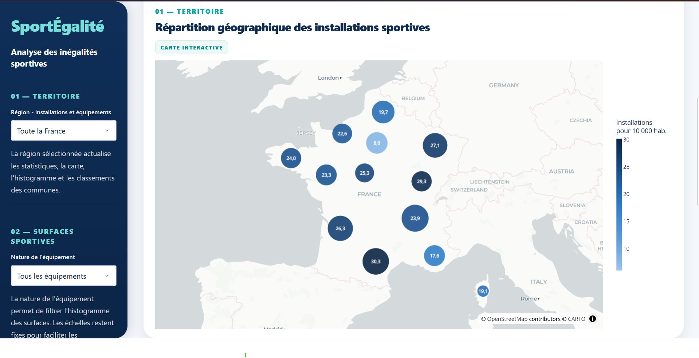
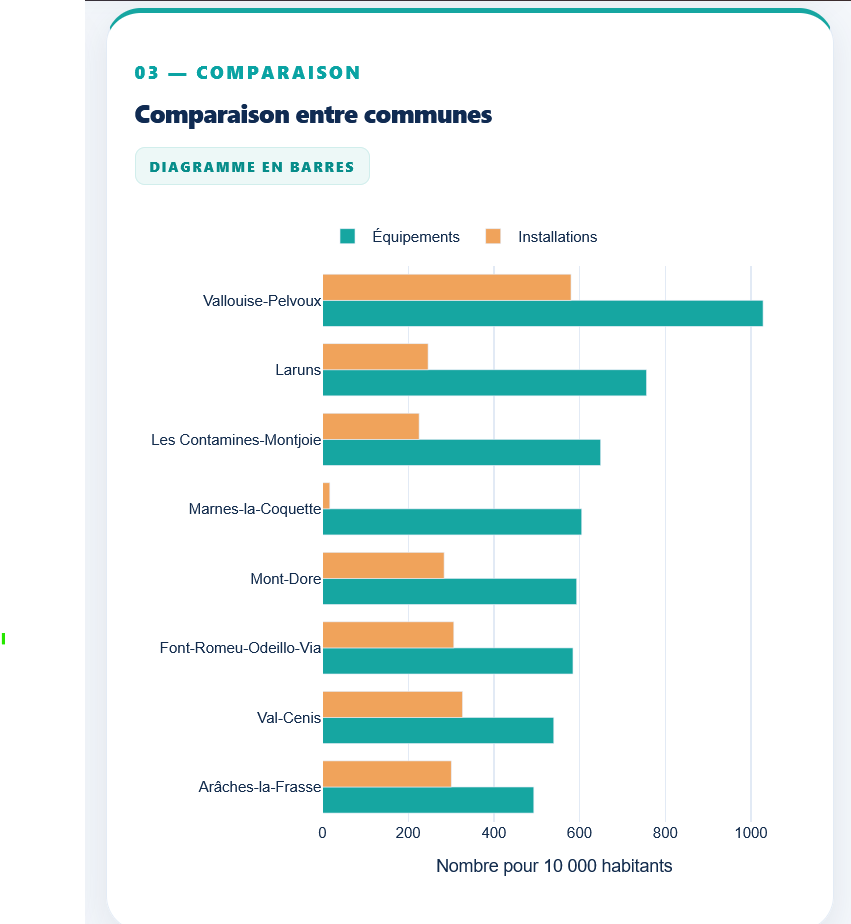

## Rapport d'analyse
 
### Question étudiée
 
> **Toutes les communes françaises disposent-elles du même accès aux installations sportives ?**
 
Pour y répondre, nous avons croisé le recensement national des équipements sportifs
(Data ES, ministère chargé des Sports) avec la population des communes (Insee),
sous trois angles :
 
1. **Combien** d'installations chaque territoire compte **par habitant** (carte à bulles) ;
2. **Quelles communes** sont les mieux dotées pour 10 000 habitants (comparaison entre communes) ;
3. **Quelle taille** ont les équipements selon leur nature (histogramme des surfaces).
Les chiffres présentés proviennent de la base `data/db.sqlite` (tables `cleaned`,
`cleaned_installations` et `cleaned_population`). Ils peuvent être retrouvés dans
le dashboard avec les filtres indiqués pour chaque graphique.
 
**Les données analysées :**
 
| Élément                                                   | Valeur           |
|:----------------------------------------------------------|-----------------:|
| Équipements sportifs                                      |          334 371 |
| Installations sportives (brutes)                          |          152 296 |
| Installations conservées après nettoyage                  |          144 564 |
| Installations exclues (coordonnées absentes ou invalides) |            7 732 |
| Équipements rattachés à une région                        |          319 426 |
| Équipements avec une surface exploitable                  |          277 915 |
| Communes avec une population connue                       |           34 957 |
| Population totale couverte                                | 68,95 millions d'habitants |
 
Une **installation** est un lieu (un complexe sportif, un lycée, une piscine municipale).
Un **équipement** est un espace de pratique à l'intérieur de ce lieu (un gymnase,
un terrain de football, un court de tennis). Une installation contient en moyenne
**2,3 équipements** (334 371 équipements pour 144 564 installations).
 
### 1. Des écarts importants une fois rapportés à la population
 

 
La carte regroupe les installations en bulles : une bulle par région en vue
« Toute la France », qui se divise en départements puis en communes quand on zoome.
La **taille** d'une bulle correspond au nombre d'installations, et sa **couleur**
ainsi que le **nombre écrit dedans** au nombre d'**installations pour 10 000 habitants**.
 
En France, on compte en moyenne **environ 21 installations pour 10 000 habitants**
(144 564 installations pour 68,95 millions d'habitants). Les écarts entre régions
de métropole sont importants :
 
| Région                     | Installations pour 10 000 habitants |
|:---------------------------|------------------------------------:|
| Occitanie                  |                            **30,3** |
| Bourgogne-Franche-Comté    |                                29,3 |
| Grand Est                  |                                27,1 |
| Nouvelle-Aquitaine         |                                26,3 |
| Centre-Val de Loire        |                                25,3 |
| Bretagne                   |                                24,0 |
| Auvergne-Rhône-Alpes       |                                23,9 |
| Pays de la Loire           |                                23,3 |
| Normandie                  |                                22,6 |
| Hauts-de-France            |                                19,7 |
| Corse                      |                                19,1 |
| Provence-Alpes-Côte d'Azur |                                17,6 |
| Île-de-France              |                             **8,0** |
 
L'**Île-de-France** est la région la plus peuplée (12,5 millions d'habitants) et compte
près de 10 000 installations, mais elle en a **près de quatre fois moins par habitant**
que l'Occitanie. Les régions d'outre-mer sont aussi en dessous de la moyenne
(de 9,6 à Mayotte à 18,6 en Martinique).

 
En zoomant, le même phénomène apparaît à une échelle plus fine :
 
- **Paris** compte environ **4,5** installations pour 10 000 habitants, et les communes
  denses de la petite couronne se situent souvent entre **5 et 10**
  (par exemple Champigny-sur-Marne : 54 installations pour 78 072 habitants, soit 6,9) ;
- les grandes villes de province sont aussi sous la moyenne : **Clermont-Ferrand**
  compte 150 installations pour 146 351 habitants, soit **10,2** ;
- à l'inverse, de petites communes rurales dépassent **30 ou 50** avec seulement
  quelques installations, et certaines communes de montagne d'Auvergne-Rhône-Alpes
  dépassent **250**, voire 600 (stations touristiques peu peuplées à l'année).
**Constat :** les grandes villes concentrent beaucoup d'installations en nombre, mais
**pas par habitant**. Ce sont les territoires moins denses qui sont les mieux dotés
rapportés à leur population.
 
### 2. Les communes les mieux dotées par habitant
 

 
Le graphique de comparaison réunit les **cinq communes les mieux dotées en équipements**
et les **cinq les mieux dotées en installations** pour 10 000 habitants. Pour éviter
que de très petits villages faussent le classement, seules les communes d'**au moins
1 000 habitants** sont prises en compte.
 
En **Normandie**, par exemple, le classement est dominé par des communes littorales
et touristiques comme **Houlgate** (environ 290 équipements pour 10 000 habitants),
**Étretat** et **Saint-Vaast-la-Hougue** [À VÉRIFIER au survol]. Ces communes accueillent
de nombreux visiteurs : leurs équipements ne servent pas qu'à leurs habitants.
 
On observe aussi que les deux classements ne coïncident pas toujours :
une commune peut avoir **beaucoup d'équipements regroupés sur peu de sites**
(un grand complexe), ou au contraire **de nombreux petits sites**.
 
**Choix méthodologique :** dans les données d'origine, Paris, Marseille et Lyon
sont découpées en arrondissements, chacun ayant son propre code INSEE.
Nous avons regroupé les arrondissements dans leur ville
(`regrouper_arrondissements()` dans `clean_data.py`) pour pouvoir les associer
à la population de la commune et les comparer aux autres communes.
 
**Constat :** les communes les mieux dotées par habitant sont de petites communes,
souvent touristiques, et non les grandes villes.
 
### 3. Deux grandes familles de surfaces
 

 
L'histogramme représente la surface de l'aire de pratique de chaque équipement.
Sur les 334 371 équipements, **277 915 ont une surface exploitable** :
les autres n'ont pas de surface renseignée, ou une surface nulle ou négative.
 
La distribution est très **asymétrique** : la surface médiane est de **648 m²**,
mais certains équipements dépassent plusieurs hectares. Pour rester lisible,
l'histogramme est limité à **10 800 m²**, qui correspond au 95ᵉ percentile.
Les **13 878 équipements** plus grands restent dans la base de données.
 
Deux familles de surfaces apparaissent :
 
- **les petits équipements**, de loin les plus nombreux : **65,9 %** des équipements
  font moins de 1 000 m². La première barre (0 à 216 m²) regroupe à elle seule
  **63 384 équipements**, surtout des salles polyvalentes (9 617), des terrains
  de pétanque (9 321) et des salles de musculation (5 125) ;
- **les terrains de grands jeux**, qui forment un second pic autour de 6 000 à 8 000 m²,
  la taille d'un terrain de football ou de rugby : **11,3 %** des équipements
  mesurent entre 5 000 et 9 000 m².
Le survol de chaque barre indique aussi le nombre d'équipements pour 10 000 habitants
du territoire choisi : par exemple, les équipements de moins de 216 m² représentent
**9,19 équipements pour 10 000 habitants** en France.
 
Le filtre **Nature** précise cette lecture :
 
| Nature            | Équipements | Surface médiane |
|:------------------|------------:|----------------:|
| Découvert         |     166 838 |          650 m² |
| Intérieur         |      81 677 |          252 m² |
| Extérieur couvert |       4 308 |          600 m² |
 
- Les équipements **intérieurs** (gymnases, salles) sont les plus petits,
  avec une médiane de 252 m².
- Les équipements **découverts** sont les plus nombreux (60 % des surfaces valides),
  mais restent en majorité de taille modeste (médiane de 650 m²) :
  les grands terrains de plein air n'en représentent qu'une partie.
*Environ 25 000 équipements ont une autre nature (sites naturels ou artificiels,
équipements découvrables). Ils sont inclus dans le choix « Tous les équipements »,
mais ne disposent pas d'un filtre dédié.*
 
**Constat :** la majorité des équipements sportifs sont de petite taille.
Les grands terrains, plus coûteux à construire et à entretenir, sont nettement moins nombreux.
 
### Limites de l'analyse
 
**Limites liées à la question**
 
- **Présence ne signifie pas accessibilité.** Un équipement recensé peut être réservé
  (scolaires, clubs), payant, fermé une partie de l'année ou éloigné des transports.
  La distance entre les habitants et les équipements n'est pas prise en compte.
- **Petites communes et tourisme.** Le ratio par habitant est très élevé dans les petites
  communes : quelques installations suffisent à dépasser 50 pour 10 000 habitants.
  Dans les communes touristiques, les installations servent aussi aux visiteurs,
  ce qui gonfle le ratio. La comparaison entre communes ne garde donc que les communes
  d'au moins 1 000 habitants.
- **Installations et équipements.** La carte rapporte les **installations** (les lieux)
  à la population, l'histogramme et la comparaison rapportent aussi les **équipements**.
  Une installation contenant en moyenne 2,3 équipements, les deux ratios n'ont pas
  le même ordre de grandeur.
**Limites liées aux données**
 
- **Des données déclaratives.** Le recensement Data ES est alimenté par des enquêtes et
  des déclarations, mises à jour de façon inégale selon les territoires.
  Les chiffres correspondent à la version téléchargée en novembre 2026.
- **La population.** Elle provient de l'API Découpage administratif (populations Insee).
  12 communes sans population connue ont été exclues : leurs installations n'ont pas de ratio.
- **Des équipements sans surface.** 56 456 équipements (17 %) n'ont pas de surface
  exploitable : ils ne figurent pas dans l'histogramme.
- **Des installations sans position.** 7 732 installations sans coordonnées valides
  ont été exclues de la carte. Par conséquent, environ 4,5 % des équipements n'ont pas pu
  être rattachés à une région : ils apparaissent dans la vue « Toute la France »,
  mais pas dans les vues régionales.
**Limites liées aux choix de représentation**
 
- **Une carte à bulles.** Chaque bulle est placée au centre moyen des installations de son
  territoire. L'échelle de couleurs s'adapte aux bulles affichées : une même couleur ne
  correspond pas à la même valeur en vue France et en vue commune, c'est pourquoi le ratio
  est écrit dans chaque bulle.
- **Un histogramme tronqué.** L'affichage est limité à 10 800 m² pour rester lisible.
  Les 13 878 équipements plus grands restent dans la base, mais ne sont pas représentés.
- **Un filtre « Nature » incomplet.** Environ 25 000 équipements ont une autre nature
  que celles proposées : ils sont inclus dans « Tous les équipements »,
  mais ne peuvent pas être sélectionnés seuls.
- **Le regroupement des arrondissements.** Paris, Marseille et Lyon sont traitées
  comme une seule commune chacune. Ce choix permet de les comparer aux autres communes,
  mais masque les écarts entre arrondissements.
### Conclusion
 
> **Toutes les communes françaises disposent-elles du même accès aux installations sportives ?**
 
Nos données montrent que **non**, mais pas forcément là où on l'attend :
 
- **en nombre**, l'offre sportive est concentrée dans les grandes villes ;
- **rapportée à la population**, la situation s'inverse : l'Île-de-France compte
  8 installations pour 10 000 habitants, presque quatre fois moins que l'Occitanie (30,3),
  et Paris ainsi que les communes denses de la petite couronne sont parmi les moins
  bien dotées (partie 1) ;
- les communes les mieux dotées par habitant sont de petites communes, souvent
  touristiques (partie 2) ;
- la grande majorité des équipements sont de **petite taille** : 65,9 % font moins
  de 1 000 m² (partie 3).
Ces résultats mesurent la **présence** des installations par habitant, et non
l'**accès réel** : pour aller plus loin, il faudrait tenir compte de la distance
entre les habitants et les équipements, et de leurs conditions d'accès
(horaires, tarifs, public autorisé).